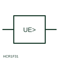

# Earth-fault voltage relay

Relay form that operates on a voltage appearing because of an earth fault, such as between a frame and earth.

[Canonical reference](https://eloragrid.ai/symbols/earth-fault-voltage-relay) · [Structured record](../entries/earth-fault-voltage-relay.json) · [All references](README.md)

Updated: 2026-10-28. Drawing use: Schematic, SLD. Reference families: IEC, Manufacturer.

## What it represents

This relay measures a voltage that appears only when there is an earth fault, for example between exposed metalwork and a reference earth, or across a neutral earthing impedance. It is useful where earth-fault current is limited and a voltage is easier to detect than a current.
The symbol does not say where the voltage is measured. A relay across a neutral earthing resistor and one connected between frame and auxiliary earth electrode have very different settings, so the measurement points must be drawn and labelled.

## How to read it

- Trace both measurement connections of the relay.
- Check the reference earth used by the relay.

## Drawing checklist

- Show measurement points
- State threshold and delay
- Reference earthing arrangement

## Important distinction

An earth-fault voltage relay measures fault-related voltage; a residual voltage relay measures zero-sequence voltage from VT windings.

## Facts

- Measured quantity: Voltage caused by an earth fault
- Publisher reference token: HCR1F31 (Autodesk identifier; not an IEC database ID)
- Preview: Independent educational concept; consult the publisher and applicable standard for the exact graphic

## Public references

- [AutoCAD Electrical: Voltage monitoring relays](https://help.autodesk.com/cloudhelp/2021/ENU/AutoCAD-Electrical/files/GUID-5296749E-9336-4B07-9956-160963D6C848.htm) — Autodesk. Public AutoCAD Electrical relay listing that names the Ground Failure Voltage Protection block; the illustration is independently drawn.
- [Residual current and neutral-earthing protection context](https://new.abb.com/medium-voltage/digital-substations/campaigns/earth-fault-protection-portfolio/earth-fault-offering) — ABB. Public context for neutral-earthing and earth-fault protection.

## Related references

- [Residual-voltage monitoring relay](residual-voltage-monitoring-relay.md)
- [Earth-fault current relay](earth-fault-current-relay.md)
- [Ground detector protection](64-ground-detector-protection.md)

Original educational concept geometry, CC BY 4.0. Unitless; not a certified standards glyph or manufacturer footprint.

Elora-authored explanations are CC BY 4.0. Linked standards and manufacturer material retain their own rights. Confirm project requirements using primary sources.
