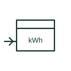

# Energy meter repeater

Remote register that counts pulses from a transmitting energy meter and repeats its reading at another location.

[Canonical reference](https://eloragrid.ai/symbols/energy-meter-repeater) · [Structured record](../entries/energy-meter-repeater.json) · [All references](README.md)

Updated: 2026-10-28. Drawing use: Schematic. Reference families: IEC.

## What it represents

An energy meter repeater has no measuring inputs of its own. It counts pulses from a transmitting meter and displays the resulting energy at a control room or tenant panel, so on the drawing it connects only to a signal circuit rather than to CTs and VTs.
Because it counts pulses, the repeater can drift from the master meter if pulses are lost or the supply is interrupted. The symbol does not show whether it has non-volatile memory or how it is reconciled with the master, which matters if the repeater is used for billing.

## How to read it

- Confirm the repeater has no direct measuring inputs.
- Check the pulse weight matches the transmitting meter.

## Drawing checklist

- Reference the master meter
- State pulse weight
- Show signal supply

## Important distinction

A repeater counts pulses from another meter; a summation meter adds pulses from several meters.

## Facts

- Input: Pulse signal from a transmitting meter
- Measuring inputs: None
- Preview: Independent educational concept; consult the applicable standard and project legend for the exact graphic

## Public references

- [IEC graphical symbols for diagrams](https://tc3.iec.ch/tc-activity/graphical-symbols-for-diagrams/) — IEC. IEC context for graphical symbols used in diagrams; no IEC graphic is reproduced.

## Related references

- [Energy meter with pulse transmitter](energy-meter-with-pulse-transmitter.md)
- [Summation energy meter](summation-energy-meter.md)
- [Active-energy meter](active-energy-meter.md)

Original educational concept geometry, CC BY 4.0. Unitless; not a certified standards glyph or manufacturer footprint.

Elora-authored explanations are CC BY 4.0. Linked standards and manufacturer material retain their own rights. Confirm project requirements using primary sources.
