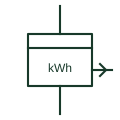

# Energy meter with pulse transmitter

Energy meter that sends a pulse output proportional to energy for remote counting, totalising or building management.

[Canonical reference](https://eloragrid.ai/symbols/energy-meter-with-pulse-transmitter) · [Structured record](../entries/energy-meter-with-pulse-transmitter.json) · [All references](README.md)

Updated: 2026-10-28. Drawing use: SLD, Schematic. Reference families: IEC, Manufacturer.

## What it represents

This form shows an energy meter with a transmitting output, normally a pulse contact where each pulse represents a fixed amount of energy. The output feeds a remote counter, a summation meter, a PLC or a building management system, so the meter symbol is linked to a separate signal circuit.
The pulse weight, such as watt-hours per pulse, and the pulse width are essential for the receiver. The symbol does not show them, and a mismatch between pulse weight and receiver scaling produces errors that are easy to miss.

## How to read it

- Record the pulse weight and width.
- Trace the pulse output to its receiving device.

## Drawing checklist

- State pulse weight
- Show output contact wiring
- Reference receiving input scaling

## Important distinction

A meter with a transmitter sends its count elsewhere; an energy meter repeater is the receiving remote register.

## Facts

- Output: Pulses proportional to energy
- Key data: Pulse weight and width
- Preview: Independent educational concept; consult the applicable standard and project legend for the exact graphic

## Public references

- [Power and energy measurement quantities](https://www.se.com/ph/en/faqs/FA343278/) — Schneider Electric. Public explanation of energy and power measurement quantities used by meters.
- [IEC graphical symbols for diagrams](https://tc3.iec.ch/tc-activity/graphical-symbols-for-diagrams/) — IEC. IEC context for graphical symbols used in diagrams; no IEC graphic is reproduced.

## Related references

- [Energy meter repeater](energy-meter-repeater.md)
- [Summation energy meter](summation-energy-meter.md)
- [Active-energy meter](active-energy-meter.md)

Original educational concept geometry, CC BY 4.0. Unitless; not a certified standards glyph or manufacturer footprint.

Elora-authored explanations are CC BY 4.0. Linked standards and manufacturer material retain their own rights. Confirm project requirements using primary sources.
