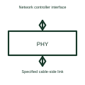

# Ethernet physical-layer transceiver

An Ethernet PHY handles the electrical signalling of the selected Ethernet physical link.

[Canonical reference](https://eloragrid.ai/symbols/ethernet-phy) · [Structured record](../entries/ethernet-phy.json) · [All references](README.md)

Updated: 2026-10-27. Drawing use: Schematic. Reference families: Manufacturer.

## What it represents

An Ethernet PHY handles the electrical signalling of the selected Ethernet physical link.
A network controller can connect through a PHY and its associated interface components to a cable.
Draw the link between the network controller and PHY separately from the cable-side interface. The PHY handles the physical signalling of the chosen Ethernet variant. The connector, magnetics where required, cable and controller interface still have to match the selected design. This is original functional artwork, not a certified standard graphic or device pinout.

## How to read it

- Identify the supported Ethernet physical-layer variant.
- Show the selected controller-to-PHY interface.
- Reference connector, cable and line-interface requirements.
- A PHY is not a complete Ethernet switch, router or application controller.

## Drawing checklist

- Identify the supported Ethernet physical-layer variant.
- Show the selected controller-to-PHY interface.
- Reference connector, cable and line-interface requirements.

## Important distinction

A PHY is not a complete Ethernet switch, router or application controller.

## Facts

- Representation type: Original functional block; not a certified IEC or IEEE graphic
- Concept input: Network controller interface
- Concept output: Specified cable-side link

## Public references

- [Ethernet physical interfaces](https://www.ti.com/product-category/interface/ethernet-ics/overview.html) — Texas Instruments. Ethernet physical interfaces: public technical context for the named function. Product and compliance details remain with the publisher.

## Related references

- [Industrial Ethernet switch](ga-industrial-ethernet-switch.md)
- [Single-pair Ethernet interface](single-pair-ethernet-interface.md)
- [Power converter / inverter](power-converter.md)
- [Terminal connection](terminal.md)

Original educational concept geometry, CC BY 4.0. Unitless; not a certified standards glyph or manufacturer footprint.

Elora-authored explanations are CC BY 4.0. Linked standards and manufacturer material retain their own rights. Confirm project requirements using primary sources.
