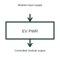

# EV charger power module

A charger power module is one conversion building block within a charging system.

[Canonical reference](https://eloragrid.ai/symbols/ev-charger-power-module) · [Structured record](../entries/ev-charger-power-module.json) · [All references](README.md)

Updated: 2026-10-27. Drawing use: Schematic. Reference families: Manufacturer.

## What it represents

A charger power module is one conversion building block within a charging system.
A charging station can coordinate several selected modules to supply its DC output.
Show the module as a conversion building block inside the station, rather than the complete charger. Label its power input, controlled output and supervisory interface. Where several modules are used, identify their arrangement instead of assuming their output ratings can simply be added. This is original functional artwork, not a certified standard graphic or device pinout.

## How to read it

- Identify the module input and output interfaces.
- Show module control and any shared-output arrangement.
- Reference the module cooling, installation and compatibility documents.
- The power module is not the complete station, communications interface or protective installation.

## Drawing checklist

- Identify the module input and output interfaces.
- Show module control and any shared-output arrangement.
- Reference the module cooling, installation and compatibility documents.

## Important distinction

The power module is not the complete station, communications interface or protective installation.

## Facts

- Representation type: Original functional block; not a certified IEC or IEEE graphic
- Concept input: Module input supply
- Concept output: Controlled module output

## Public references

- [DC fast charging architecture](https://www.ti.com/solution/dc-fast-charging-station) — Texas Instruments. DC fast charging architecture: public technical context for the named function. Product and compliance details remain with the publisher.

## Related references

- [DC-to-AC inverter](dc-to-ac-inverter.md)
- [DC electric vehicle charging station](dc-ev-charging-station.md)
- [Bidirectional EV charging interface](bidirectional-ev-charging-interface.md)
- [EV charging energy measurement](ev-charging-energy-meter.md)

Original educational concept geometry, CC BY 4.0. Unitless; not a certified standards glyph or manufacturer footprint.

Elora-authored explanations are CC BY 4.0. Linked standards and manufacturer material retain their own rights. Confirm project requirements using primary sources.
