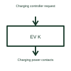

# EV charging contactor control

A charging contactor control function commands the switching device in the charging power path.

[Canonical reference](https://eloragrid.ai/symbols/ev-charging-contactor-control) · [Structured record](../entries/ev-charging-contactor-control.json) · [All references](README.md)

Updated: 2026-10-27. Drawing use: Schematic. Reference families: Manufacturer.

## What it represents

A charging contactor control function commands the switching device in the charging power path.
A charging controller can close the selected contactor only when the required operating conditions are satisfied.
Draw the contactor coil command separately from the main contacts carrying charging power. If the design monitors contact position, show that feedback as another signal. This makes it clear that requesting a change and confirming the physical contact state are different parts of the control sequence. This is original functional artwork, not a certified standard graphic or device pinout.

## How to read it

- Identify the coil or actuator interface.
- Distinguish main contacts from auxiliary feedback contacts.
- Reference the selected charging sequence and interlocks.
- A control command does not itself verify that the contactor contacts reached the requested state.

## Drawing checklist

- Identify the coil or actuator interface.
- Distinguish main contacts from auxiliary feedback contacts.
- Reference the selected charging sequence and interlocks.

## Important distinction

A control command does not itself verify that the contactor contacts reached the requested state.

## Facts

- Representation type: Original functional block; not a certified IEC or IEEE graphic
- Concept input: Charging controller request
- Concept output: Charging power contacts

## Public references

- [AC electric vehicle charging architecture](https://www.ti.com/solution/ac-charging-pile-station) — Texas Instruments. AC electric vehicle charging architecture: public technical context for the named function. Product and compliance details remain with the publisher.

## Related references

- [Contactor](contactor.md)
- [AC electric vehicle charge point](ac-ev-charge-point.md)
- [EV control pilot interface](ev-control-pilot-interface.md)
- [EV charging residual-current detection](ev-residual-current-detection.md)

Original educational concept geometry, CC BY 4.0. Unitless; not a certified standards glyph or manufacturer footprint.

Elora-authored explanations are CC BY 4.0. Linked standards and manufacturer material retain their own rights. Confirm project requirements using primary sources.
