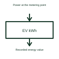

# EV charging energy measurement

Charging energy measurement records the electrical energy passing through the defined measuring point.

[Canonical reference](https://eloragrid.ai/symbols/ev-charging-energy-meter) · [Structured record](../entries/ev-charging-energy-meter.json) · [All references](README.md)

Updated: 2026-10-27. Drawing use: Schematic. Reference families: Manufacturer.

## What it represents

Charging energy measurement records the electrical energy passing through the defined measuring point.
A station can use the measurement to report energy delivered during a charging session.
Locate the measuring point on the power path and label whether it is on the AC input or DC output side. Energy adds up over time, whereas power is a rate at a particular moment. The location matters because losses between two points can make their recorded energy differ. This is original functional artwork, not a certified standard graphic or device pinout.

## How to read it

- Identify the metering point and measured circuit.
- Distinguish energy readings from instantaneous power.
- Reference the selected meter’s measurement and reporting requirements.
- Measurement placement and system losses affect what an energy value represents.

## Drawing checklist

- Identify the metering point and measured circuit.
- Distinguish energy readings from instantaneous power.
- Reference the selected meter’s measurement and reporting requirements.

## Important distinction

Measurement placement and system losses affect what an energy value represents.

## Facts

- Representation type: Original functional block; not a certified IEC or IEEE graphic
- Concept input: Power at the metering point
- Concept output: Recorded energy value

## Public references

- [DC fast charging architecture](https://www.ti.com/solution/dc-fast-charging-station) — Texas Instruments. DC fast charging architecture: public technical context for the named function. Product and compliance details remain with the publisher.

## Related references

- [DC-to-AC inverter](dc-to-ac-inverter.md)
- [DC electric vehicle charging station](dc-ev-charging-station.md)
- [Bidirectional EV charging interface](bidirectional-ev-charging-interface.md)
- [EV charger power module](ev-charger-power-module.md)

Original educational concept geometry, CC BY 4.0. Unitless; not a certified standards glyph or manufacturer footprint.

Elora-authored explanations are CC BY 4.0. Linked standards and manufacturer material retain their own rights. Confirm project requirements using primary sources.
