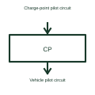

# EV control pilot interface

The control pilot is part of the signalling interface between charging equipment and a vehicle.

[Canonical reference](https://eloragrid.ai/symbols/ev-control-pilot-interface) · [Structured record](../entries/ev-control-pilot-interface.json) · [All references](README.md)

Updated: 2026-10-27. Drawing use: Schematic. Reference families: Manufacturer.

## What it represents

The control pilot is part of the signalling interface between charging equipment and a vehicle.
Charging equipment can use pilot signalling to coordinate a permitted charging state.
Show the pilot connection beside, but separate from, the charging power conductors. It carries interface information used in the charging sequence. Label the charger side and vehicle side, and refer to the selected charging-system documentation for the applicable signal interpretation. This is original functional artwork, not a certified standard graphic or device pinout.

## How to read it

- Identify which side is the charge point and which is the vehicle.
- Keep pilot wiring separate from the main power path.
- Reference the applicable interface and fault-state requirements.
- A pilot signal is a control interface, not the main charging power conductor.

## Drawing checklist

- Identify which side is the charge point and which is the vehicle.
- Keep pilot wiring separate from the main power path.
- Reference the applicable interface and fault-state requirements.

## Important distinction

A pilot signal is a control interface, not the main charging power conductor.

## Facts

- Representation type: Original functional block; not a certified IEC or IEEE graphic
- Concept input: Charge-point pilot circuit
- Concept output: Vehicle pilot circuit

## Public references

- [AC electric vehicle charging architecture](https://www.ti.com/solution/ac-charging-pile-station) — Texas Instruments. AC electric vehicle charging architecture: public technical context for the named function. Product and compliance details remain with the publisher.

## Related references

- [Contactor](contactor.md)
- [AC electric vehicle charge point](ac-ev-charge-point.md)
- [EV charging residual-current detection](ev-residual-current-detection.md)
- [EV charging contactor control](ev-charging-contactor-control.md)

Original educational concept geometry, CC BY 4.0. Unitless; not a certified standards glyph or manufacturer footprint.

Elora-authored explanations are CC BY 4.0. Linked standards and manufacturer material retain their own rights. Confirm project requirements using primary sources.
