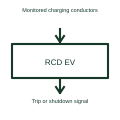

# EV charging residual-current detection

Residual-current detection checks for specified unintended current paths in a charging system.

[Canonical reference](https://eloragrid.ai/symbols/ev-residual-current-detection) · [Structured record](../entries/ev-residual-current-detection.json) · [All references](README.md)

Updated: 2026-10-27. Drawing use: Schematic. Reference families: Manufacturer.

## What it represents

Residual-current detection checks for specified unintended current paths in a charging system.
Charging equipment can use a detection result to request disconnection through its protective arrangement.
Show the conductors included in the measurement and the signal sent to the charging controller or protective device. The detector looks for a specified imbalance or leakage condition. Its block should not imply that sensing and opening the power circuit happen in the same physical component. This is original functional artwork, not a certified standard graphic or device pinout.

## How to read it

- Identify the conductors included in the detection arrangement.
- Reference the types of residual current the selected device detects.
- Show the trip or shutdown connection to the interrupting device.
- A detector and the device that physically disconnects power are not automatically the same component.

## Drawing checklist

- Identify the conductors included in the detection arrangement.
- Reference the types of residual current the selected device detects.
- Show the trip or shutdown connection to the interrupting device.

## Important distinction

A detector and the device that physically disconnects power are not automatically the same component.

## Facts

- Representation type: Original functional block; not a certified IEC or IEEE graphic
- Concept input: Monitored charging conductors
- Concept output: Trip or shutdown signal

## Public references

- [AC electric vehicle charging architecture](https://www.ti.com/solution/ac-charging-pile-station) — Texas Instruments. AC electric vehicle charging architecture: public technical context for the named function. Product and compliance details remain with the publisher.

## Related references

- [Contactor](contactor.md)
- [AC electric vehicle charge point](ac-ev-charge-point.md)
- [EV control pilot interface](ev-control-pilot-interface.md)
- [EV charging contactor control](ev-charging-contactor-control.md)

Original educational concept geometry, CC BY 4.0. Unitless; not a certified standards glyph or manufacturer footprint.

Elora-authored explanations are CC BY 4.0. Linked standards and manufacturer material retain their own rights. Confirm project requirements using primary sources.
