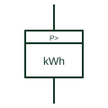

# Excess-energy meter

Integrating meter that counts only the energy taken while power is above a set threshold.

[Canonical reference](https://eloragrid.ai/symbols/excess-energy-meter) · [Structured record](../entries/excess-energy-meter.json) · [All references](README.md)

Updated: 2026-10-28. Drawing use: SLD, Schematic. Reference families: IEC.

## What it represents

An excess-energy meter records energy only for the part of the load above a set power level. It was used for tariffs that penalised consumption beyond an agreed capacity, and the same idea appears in modern meters as threshold registers.
The symbol identifies the excess function but not the threshold, which is a contractual value that must be written beside the meter. Without that value the register cannot be interpreted or checked.

## How to read it

- Find the stated power threshold.
- Check the register is read with the main energy register.

## Drawing checklist

- State threshold power
- Reference tariff clause
- Show measuring inputs

## Important distinction

An excess-energy meter counts only energy above a threshold; a maximum-demand meter records the highest average power.

## Facts

- Integrated quantity: Energy above a set power
- Key setting: Power threshold
- Preview: Independent educational concept; consult the applicable standard and project legend for the exact graphic

## Public references

- [IEC graphical symbols for diagrams](https://tc3.iec.ch/tc-activity/graphical-symbols-for-diagrams/) — IEC. IEC context for graphical symbols used in diagrams; no IEC graphic is reproduced.
- [Power and energy measurement quantities](https://www.se.com/ph/en/faqs/FA343278/) — Schneider Electric. Public explanation of energy and power measurement quantities used by meters.

## Related references

- [Active-energy meter](active-energy-meter.md)
- [Energy meter with maximum-demand indicator](maximum-demand-energy-meter.md)
- [Integrating instrument general symbol](integrating-instrument-general-symbol.md)

Original educational concept geometry, CC BY 4.0. Unitless; not a certified standards glyph or manufacturer footprint.

Elora-authored explanations are CC BY 4.0. Linked standards and manufacturer material retain their own rights. Confirm project requirements using primary sources.
