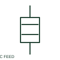

# Feedthrough capacitor

A feedthrough capacitor is arranged with a conductor path and a documented capacitive connection used in filtering.

[Canonical reference](https://eloragrid.ai/symbols/feedthrough-capacitor) · [Structured record](../entries/feedthrough-capacitor.json) · [All references](README.md)

Updated: 2026-10-27. Drawing use: SLD, Schematic. Reference families: IEC, Manufacturer.

## What it represents

A feedthrough capacitor is arranged with a conductor path and a documented capacitive connection used in filtering. The schematic must identify both the through path and the return connection.

## How to read it

- Trace the filtered conductor separately from the capacitive return.
- The preview is an original explanation of this function. Match the actual drawing convention to its legend and the selected equipment documentation.

## Drawing checklist

- Show through conductor
- Identify return or case connection
- Reference component rating

## Important distinction

A feedthrough capacitor is a filter connection arrangement, not a removable wiring terminal.

## Facts

- Drawing role: Passive circuit element
- Representation scope: Functional concept; not an official standard graphic or a product footprint
- Public vendor block reference: HCA1C2, VCA1C2 (Autodesk identifiers; not IEC symbol numbers)
- Identifier status: The short label is a functional lookup label, not an assigned IEC or IEEE symbol number. Any separately listed Autodesk code is a verified vendor block name.

## Public references

- [Capacitive component symbols](https://help.autodesk.com/cloudhelp/2021/ENU/AutoCAD-Electrical/files/GUID-74580D46-0731-41A6-918D-2DB419114207.htm) — Autodesk. Public documentation of this equipment function or named vendor variant; the illustration is independently authored and is not the source graphic.

## Related references

- [Resistor](resistor.md)
- [Capacitor](capacitor.md)

Original educational concept geometry, CC BY 4.0. Unitless; not a certified standards glyph or manufacturer footprint.

Elora-authored explanations are CC BY 4.0. Linked standards and manufacturer material retain their own rights. Confirm project requirements using primary sources.
