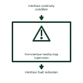

# Fire-interface healthy-loop supervision

Monitors the defined health of the connection between fire and electrical control systems.

[Canonical reference](https://eloragrid.ai/symbols/fire-interface-healthy-loop-supervision) · [Structured record](../entries/fire-interface-healthy-loop-supervision.json) · [All references](README.md)

Updated: 2026-11-03. Drawing use: Schematic. Reference families: Manufacturer.

Representation: functional-block; installation focus: switchrooms.
Interface continuity condition
Interface fault indication

## What it represents

Monitors the defined health of the connection between fire and electrical control systems. A fire-system interface passes defined indications and control requests between the fire installation and electrical equipment. The receiving circuit must identify the exact purpose of the signal and the equipment it affects.
In a switchroom, the fire panel may report detection, system faults and a separately documented shutdown request to the station controller. These signals have different meanings and must not be combined into one unexplained alarm. For this reference, the drawing identifies “Interface continuity condition” at the input and “Interface fault indication” at the output. Supervision depends on the selected circuit arrangement.
Use the coordinated fire cause-and-effect schedule to define each response. Original interface blocks describe signal roles without specifying suppression operation, evacuation behavior or life-safety performance. The functional block is an independent explanation of this named application. Equipment-specific ratings, terminal connections and operating conditions must be established in the project documentation.

## How to read it

- Start at the named input: Interface continuity condition. Identify its source device or document and the state represented on the drawing.
- Follow the named output: Interface fault indication. Cross-reference its destination and separate the command from confirmation that the equipment responded.
- Supervision depends on the selected circuit arrangement.
- Use the coordinated fire cause-and-effect schedule to define each response. Original interface blocks describe signal roles without specifying suppression operation, evacuation behavior or life-safety performance.

## Drawing checklist

- Label the source and connection reference for interface continuity condition.
- Identify the destination and defined state of interface fault indication.
- Record the equipment or control-document revision supporting this functional block.
- Check this application limit in the project design: Supervision depends on the selected circuit arrangement.

## Important distinction

Supervision depends on the selected circuit arrangement. This reference describes the named application; it does not establish a new IEC graphical symbol, an ANSI device-function number or an exact manufacturer connection diagram.

## Facts

- Representation: Functional block
- Installation focus: Switchrooms
- Input / boundary: Interface continuity condition
- Output / connection: Interface fault indication
- Lookup label: FHS is a library lookup label, not a standard device designation.

## Public references

- [Indoor substation: lighting, fire and auxiliary services](https://www.electrical-installation.org/enwiki/Indoor_substation) — Schneider Electric. Public technical context for switchroom fire and emergency interfaces. Lighting, emergency lighting, fire provisions and substation auxiliary services. Original cause-and-effect examples require project design. The application text and educational graphic are independently authored; the publisher does not certify this representation.

## Related references

- [Fire alarm control panel plan symbol](iec-fire-alarm-control-panel-plan-symbol.md)
- [Battery fire-system interface panel](ga-battery-fire-system-interface-panel.md)
- [Fire cause-and-effect output matrix](fire-cause-and-effect-output-matrix.md)

Original educational concept geometry, CC BY 4.0. Unitless; not a certified standards glyph or manufacturer footprint.

Elora-authored explanations are CC BY 4.0. Linked standards and manufacturer material retain their own rights. Confirm project requirements using primary sources.
