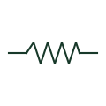

# Flexible conductor

A wavy conductor line showing a connection that must flex, such as a lead to moving equipment or a vibration break.

[Canonical reference](https://eloragrid.ai/symbols/flexible-conductor) · [Structured record](../entries/flexible-conductor.json) · [All references](README.md)

Updated: 2026-10-28. Drawing use: Schematic, SLD. Reference families: IEC, IEEE / ANSI.

## What it represents

The flexible conductor mark replaces a straight run of conductor with a wave or loop to show that the connection is intended to bend in service. Typical uses are leads to hinged doors, pendant control stations, crane festoons, motor terminal boxes on resilient mounts and short links that absorb thermal movement between busbars and equipment.
On a schematic the wave says nothing about the cable construction. Stranding class, insulation type, bending radius and the number of operating cycles must come from the cable schedule or equipment specification. A drafter should not use the wave simply to make a long wire look tidy, because a reader will assume a moving or vibrating part exists at that point.

## How to read it

- Look for the moving or vibrating item at one end of the wavy section.
- Check the cable schedule for a flexible stranding class and any drag-chain or festoon rating.

## Drawing checklist

- Identify the moving part the flexible section serves.
- Reference a cable type suited to repeated flexing.
- Show strain relief or termination details where the lead leaves the moving part.

## Important distinction

A flexible conductor bends in service; a twisted-pair mark shows conductors twisted together for noise rejection and implies nothing about movement.

## Facts

- Graphic cue: Wave or loop drawn in an otherwise straight conductor
- Typical use: Door leads, festoons, motor terminal links and thermal expansion links
- Preview: Original educational illustration; consult the publisher and applicable standard for the exact graphic

## Public references

- [IEC-60617 symbol preview directory](https://help.autodesk.com/cloudhelp/2021/ENU/AutoCAD-Electrical/files/GUID-7871E6EF-24D5-467E-9B74-321FEDC9DFDA.htm) — Autodesk. Public IEC-60617 symbol preview directory used to locate conductor and connection families.
- [IEEE/ANSI 315-1975: graphic symbols for electrical and electronics diagrams](https://standards.ieee.org/ieee/315/515/) — IEEE Standards Association. Graphic-symbol standards context for conductor forms; not a source of reproduced artwork.

## Related references

- [Twisted-pair indication](iec-twisted-pair-indication.md)
- [Flexible busbar connection](ga-flexible-busbar-connection.md)
- [Terminal connection](terminal.md)

Original educational concept geometry, CC BY 4.0. Unitless; not a certified standards glyph or manufacturer footprint.

Elora-authored explanations are CC BY 4.0. Linked standards and manufacturer material retain their own rights. Confirm project requirements using primary sources.
