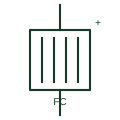

# Fuel cell

An electrochemical source that converts hydrogen or another fuel directly into DC electricity, usually followed by a converter.

[Canonical reference](https://eloragrid.ai/symbols/fuel-cell) · [Structured record](../entries/fuel-cell.json) · [All references](README.md)

Updated: 2026-10-28. Drawing use: SLD, Schematic. Reference families: IEC, IEEE / ANSI.

## What it represents

A fuel cell produces DC electricity from an electrochemical reaction between a fuel, usually hydrogen, and oxygen from air. Unlike a battery it does not store its reactants; it runs as long as fuel is supplied. Stack voltage falls noticeably with load current, so a DC/DC converter or inverter almost always follows it.
Drawings show the cell or stack as a rectangle with plates, or as a cell symbol labelled FC, with positive and negative DC leads. Balance-of-plant items such as the air blower, humidifier and coolant pump are auxiliary loads and normally appear on a separate auxiliary supply drawing.
The symbol does not state whether the stack can follow fast load changes. Most fuel cell systems pair with a battery or supercapacitor to cover transients, and the fuel supply, purge and safety interlocks belong on the process drawings.

## How to read it

- Expect a converter and often a battery buffer next to the stack.
- Separate stack output from auxiliary consumption when reading ratings.

## Drawing checklist

- State stack voltage range and current.
- Show converter and buffer storage.
- Reference fuel supply and safety interlocks.

## Important distinction

A fuel cell converts supplied fuel continuously; a battery stores a fixed charge and must be recharged.

## Facts

- Output: DC, voltage falls with load
- Fuel: Usually hydrogen
- Typical pairing: DC/DC converter and buffer storage
- Preview: Independent educational illustration; consult the applicable standard and project legend for the exact graphic

## Public references

- [IEC graphical symbols for diagrams](https://tc3.iec.ch/tc-activity/graphical-symbols-for-diagrams/) — IEC. IEC graphical symbol context for sources and conversion elements.
- [Battery energy storage and power conversion](https://www.eaton.com/sg/en-us/products/energy-storage.html) — Eaton. Public energy storage and power conversion context.

## Related references

- [Hydrogen electrolyser](hydrogen-electrolyser.md)
- [DC-to-DC converter](dc-to-dc-converter.md)
- [Battery](battery.md)
- [Supercapacitor bank](supercapacitor-bank.md)

Original educational concept geometry, CC BY 4.0. Unitless; not a certified standards glyph or manufacturer footprint.

Elora-authored explanations are CC BY 4.0. Linked standards and manufacturer material retain their own rights. Confirm project requirements using primary sources.
