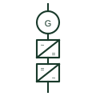

# Full-converter wind turbine generator (Type 4)

A wind turbine whose entire generator output passes through a full-rated back-to-back converter before reaching the network.

[Canonical reference](https://eloragrid.ai/symbols/full-converter-wind-turbine-generator) · [Structured record](../entries/full-converter-wind-turbine-generator.json) · [All references](README.md)

Updated: 2026-10-28. Drawing use: SLD. Reference families: IEC, IEEE / ANSI.

## What it represents

In a Type 4 turbine the generator, commonly a permanent-magnet or wound-field synchronous machine and sometimes an induction machine, is fully decoupled from the network by a back-to-back converter rated for the whole turbine output. The machine-side converter rectifies variable-frequency generator output to a DC link and the grid-side converter produces network-frequency AC.
Single-line drawings show the generator circle, a machine-side converter block, a DC link with chopper or brake resistor, a grid-side converter block and the line filter before the step-up transformer. Some drawings collapse this to a generator and a single converter symbol labelled with the conversion direction.
The network sees a converter, not a rotating machine, so fault current is limited to the converter capability and reactive output is a control function. The symbol does not tell you whether the converter is grid-following or grid-forming, which must be checked in the plant control description.

## How to read it

- Treat the turbine short-circuit contribution as converter-limited.
- A DC chopper resistor in the link absorbs energy during network faults; it is not a load.

## Drawing checklist

- State generator type and full converter rating.
- Show DC link chopper and line filter.
- Reference converter control mode and ride-through data.

## Important distinction

A Type 4 turbine routes all power through the converter; a DFIG routes only rotor slip power through it.

## Facts

- Generator type: Usually permanent-magnet synchronous
- Converter rating: Full turbine output
- Network interface: Converter-based, current limited
- Preview: Independent educational illustration; consult the applicable standard and project legend for the exact graphic

## Public references

- [Generator symbol variants](https://help.autodesk.com/cloudhelp/2021/ENU/AutoCAD-Electrical/files/GUID-09BE3BB5-9118-4302-8061-3888692E538F.htm) — Autodesk. Public permanent-magnet synchronous generator symbol context.
- [AutoCAD Electrical: Power station and substation concepts](https://help.autodesk.com/cloudhelp/2021/ENU/AutoCAD-Electrical/files/GUID-74EF80E8-018D-4A57-88BD-FF973F1B8185.htm) — Autodesk. Wind station representation used as site-level context.

## Related references

- [Permanent-magnet synchronous generator](permanent-magnet-synchronous-generator.md)
- [Doubly-fed induction generator](doubly-fed-induction-generator.md)
- [Wind generating station](wind-generating-station.md)
- [Grid-following inverter](grid-following-inverter.md)

Original educational concept geometry, CC BY 4.0. Unitless; not a certified standards glyph or manufacturer footprint.

Elora-authored explanations are CC BY 4.0. Linked standards and manufacturer material retain their own rights. Confirm project requirements using primary sources.
