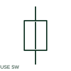

# Fuse-switch

A fuse-switch uses a fuse-link or fuse carrier as part of its moving switching contact system.

[Canonical reference](https://eloragrid.ai/symbols/fuse-switch) · [Structured record](../entries/fuse-switch.json) · [All references](README.md)

Updated: 2026-10-27. Drawing use: SLD, Schematic. Reference families: IEC, Manufacturer.

## What it represents

A fuse-switch uses a fuse-link or fuse carrier as part of its moving switching contact system. The equipment designation must identify the actual assembly rather than treating every fused switch as mechanically identical.

## How to read it

- Read the manufacturer's construction and operating instructions to establish the switching mechanism.
- The preview is an original explanation of this function. Match the actual drawing convention to its legend and the selected equipment documentation.

## Drawing checklist

- Identify assembly type
- Name compatible fuse links
- Show operating handle reference

## Important distinction

Fuse-switch describes the moving contact construction; a fused switch is a broader functional description.

## Facts

- Drawing role: Fused circuit
- Representation scope: Functional concept; not an official standard graphic or a product footprint
- Public vendor block reference: HFU1FS, VFU1FS (Autodesk identifiers; not IEC symbol numbers)
- Identifier status: The short label is a functional lookup label, not an assigned IEC or IEEE symbol number. Any separately listed Autodesk code is a verified vendor block name.

## Public references

- [AutoCAD Electrical: Fuse switches](https://help.autodesk.com/cloudhelp/2021/ENU/AutoCAD-Electrical/files/GUID-D9CE1F87-4B4C-40C7-9C9E-0136BD2A199C.htm) — Autodesk. Public documentation of this equipment function or named vendor variant; the illustration is independently authored and is not the source graphic.
- [Elementary switching devices](https://www.electrical-installation.org/enwiki/Elementary_switching_devices) — Schneider Electric — Electrical Installation Guide. Public documentation of this equipment function or named vendor variant; the illustration is independently authored and is not the source graphic.

## Related references

- [Fuse](fuse.md)
- [Load-break switch](load-break-switch.md)

Original educational concept geometry, CC BY 4.0. Unitless; not a certified standards glyph or manufacturer footprint.

Elora-authored explanations are CC BY 4.0. Linked standards and manufacturer material retain their own rights. Confirm project requirements using primary sources.
