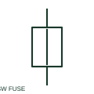

# Fused switch

A fused switch combines a switching function with fuse protection.

[Canonical reference](https://eloragrid.ai/symbols/fused-switch) · [Structured record](../entries/fused-switch.json) · [All references](README.md)

Updated: 2026-10-27. Drawing use: SLD, Schematic. Reference families: IEC, Manufacturer.

## What it represents

A fused switch combines a switching function with fuse protection. The schematic should retain both functions so the fuse rating is not confused with the switch's operational rating.

## How to read it

- Check whether the selected assembly moves the fuse carrier as part of its operation.
- The preview is an original explanation of this function. Match the actual drawing convention to its legend and the selected equipment documentation.

## Drawing checklist

- Identify fuse-link type
- State switch utilization category
- Show fuse carrier and poles

## Important distinction

A switch with separate series fuses and a fuse-switch can have different mechanical constructions.

## Facts

- Drawing role: Fused circuit
- Representation scope: Functional concept; not an official standard graphic or a product footprint
- Public vendor block reference: HDS11F, VDS11F (Autodesk identifiers; not IEC symbol numbers)
- Identifier status: The short label is a functional lookup label, not an assigned IEC or IEEE symbol number. Any separately listed Autodesk code is a verified vendor block name.

## Public references

- [AutoCAD Electrical: Fusible disconnects](https://help.autodesk.com/cloudhelp/2021/ENU/AutoCAD-Electrical/files/GUID-FE7E6B30-F585-41F4-9F66-215ACD95A36D.htm) — Autodesk. Public documentation of this equipment function or named vendor variant; the illustration is independently authored and is not the source graphic.
- [Elementary switching devices](https://www.electrical-installation.org/enwiki/Elementary_switching_devices) — Schneider Electric — Electrical Installation Guide. Public documentation of this equipment function or named vendor variant; the illustration is independently authored and is not the source graphic.

## Related references

- [Fuse](fuse.md)
- [Load-break switch](load-break-switch.md)

Original educational concept geometry, CC BY 4.0. Unitless; not a certified standards glyph or manufacturer footprint.

Elora-authored explanations are CC BY 4.0. Linked standards and manufacturer material retain their own rights. Confirm project requirements using primary sources.
