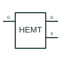

# GaN enhancement-mode HEMT

A normally-off gallium-nitride high-electron-mobility transistor used as a controlled power switch.

[Canonical reference](https://eloragrid.ai/symbols/gan-enhancement-hemt) · [Structured record](../entries/gan-enhancement-hemt.json) · [All references](README.md)

Updated: 2026-10-27. Drawing use: Schematic. Reference families: Manufacturer.

## What it represents

A normally-off gallium-nitride high-electron-mobility transistor used as a controlled power switch.
On a schematic, identify the gate, drain/source and manufacturer drive/reference requirements and trace the converter power path and dedicated gate-drive circuit. Keep the component tag and signal/reference names consistent across the control drawing, terminal schedule and device documentation.
GaN device technology should not be inferred from an ordinary MOSFET glyph; its reverse conduction and gate limits need the device documentation.
The preview is an independently drawn educational functional reference. Add the selected component’s actual power pins, terminal numbers, timing or analogue reference details when producing a construction drawing.

## How to read it

- Identify the gate, drain/source and manufacturer drive/reference requirements.
- Trace the converter power path and dedicated gate-drive circuit.

## Drawing checklist

- Label the gate, drain/source and manufacturer drive/reference requirements.
- Cross-reference the converter power path and dedicated gate-drive circuit.
- Add the selected device or circuit documentation revision, power/reference connections and project signal convention.

## Important distinction

GaN device technology should not be inferred from an ordinary MOSFET glyph; its reverse conduction and gate limits need the device documentation.

## Facts

- Common schematic mnemonic: E-HEMT — descriptive only; project/device documentation defines reference designations.
- Terminal / interface focus: The gate, drain/source and manufacturer drive/reference requirements
- Artwork scope: Original educational functional/circuit reference; not a selected product pinout.

## Public references

- [GaN HEMT structure and operating-mode overview](https://www.infineon.com/product-information/gan-hemt-structure-architecture-physics-operation) — Infineon Technologies. Public primary manufacturer documentation establishes the component function or circuit/topology relationship. Preview geometry and drafting explanations are independently authored.

## Related references

- [N-channel enhancement MOSFET](n-channel-enhancement-mosfet.md)
- [Diode](diode.md)

Original educational concept geometry, CC BY 4.0. Unitless; not a certified standards glyph or manufacturer footprint.

Elora-authored explanations are CC BY 4.0. Linked standards and manufacturer material retain their own rights. Confirm project requirements using primary sources.
