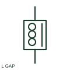

# Gapped-core inductor

A gapped-core inductor includes a documented air gap in its magnetic circuit.

[Canonical reference](https://eloragrid.ai/symbols/gapped-core-inductor) · [Structured record](../entries/gapped-core-inductor.json) · [All references](README.md)

Updated: 2026-10-27. Drawing use: SLD, Schematic. Reference families: IEC, Manufacturer.

## What it represents

A gapped-core inductor includes a documented air gap in its magnetic circuit. The drawing identifies that construction while the component data establishes inductance and operating limits.

## How to read it

- A core gap marker describes the magnetic circuit, not an electrical disconnect.
- The preview is an original explanation of this function. Match the actual drawing convention to its legend and the selected equipment documentation.

## Drawing checklist

- State inductance
- Reference current rating
- Identify gap/core construction

## Important distinction

A magnetic air gap is different from an open power-circuit connection.

## Facts

- Drawing role: Inductive component
- Representation scope: Functional concept; not an official standard graphic or a product footprint
- Public vendor block reference: HRT1L3, VRT1L3 (Autodesk identifiers; not IEC symbol numbers)
- Identifier status: The short label is a functional lookup label, not an assigned IEC or IEEE symbol number. Any separately listed Autodesk code is a verified vendor block name.

## Public references

- [AutoCAD Electrical: Reactors and inductors](https://help.autodesk.com/cloudhelp/2021/ENU/AutoCAD-Electrical/files/GUID-BAD50DBF-0951-44A0-BB4C-A57B4A4ED895.htm) — Autodesk. Public documentation of this equipment function or named vendor variant; the illustration is independently authored and is not the source graphic.

## Related references

- [Power transformer](power-transformer.md)
- [Capacitor](capacitor.md)

Original educational concept geometry, CC BY 4.0. Unitless; not a certified standards glyph or manufacturer footprint.

Elora-authored explanations are CC BY 4.0. Linked standards and manufacturer material retain their own rights. Confirm project requirements using primary sources.
