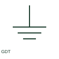

# Gas-discharge protection tube

A gas-discharge tube provides a documented surge-protection path through gas breakdown.

[Canonical reference](https://eloragrid.ai/symbols/gas-discharge-protection-tube) · [Structured record](../entries/gas-discharge-protection-tube.json) · [All references](README.md)

Updated: 2026-10-27. Drawing use: SLD, Schematic. Reference families: IEC, Manufacturer.

## What it represents

A gas-discharge tube provides a documented surge-protection path through gas breakdown. The schematic identifies its protected terminals and the intended discharge connection.

## How to read it

- Check the tube arrangement and specified operating voltage from the selected component.
- The preview is an original explanation of this function. Match the actual drawing convention to its legend and the selected equipment documentation.

## Drawing checklist

- Name protected terminals
- State discharge-tube rating
- Reference protective connection

## Important distinction

A gas-discharge tube is a protection component, not a fuse-link.

## Facts

- Drawing role: Earth or bonding role
- Representation scope: Functional concept; not an official standard graphic or a product footprint
- Public vendor block reference: HFU1\_S00374, VFU1\_S00374 (Autodesk identifiers; not IEC symbol numbers)
- Identifier status: The short label is a functional lookup label, not an assigned IEC or IEEE symbol number. Any separately listed Autodesk code is a verified vendor block name.

## Public references

- [AutoCAD Electrical: Earthing, sources and surge protection](https://help.autodesk.com/cloudhelp/2021/ENU/AutoCAD-Electrical/files/GUID-1E3FDEAE-B4B2-417C-8075-108AA2C6E509.htm) — Autodesk. Public documentation of this equipment function or named vendor variant; the illustration is independently authored and is not the source graphic.

## Related references

- [Protective earth](protective-earth.md)
- [Earthing switch](earthing-switch.md)

Original educational concept geometry, CC BY 4.0. Unitless; not a certified standards glyph or manufacturer footprint.

Elora-authored explanations are CC BY 4.0. Linked standards and manufacturer material retain their own rights. Confirm project requirements using primary sources.
