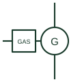

# Gas engine generator set

A spark-ignited reciprocating engine on natural gas, biogas or LPG driving an alternator, shown as a generating source.

[Canonical reference](https://eloragrid.ai/symbols/gas-engine-generator-set) · [Structured record](../entries/gas-engine-generator-set.json) · [All references](README.md)

Updated: 2026-10-28. Drawing use: SLD. Reference families: IEC, IEEE / ANSI, Manufacturer.

## What it represents

A gas engine generator set uses a spark-ignited reciprocating engine running on natural gas, biogas, landfill gas or LPG. These sets are common in combined heat and power plants, prime power microgrids and sites with a reliable gas supply, and they are often run continuously rather than only as backup.
Single-line diagrams draw the alternator circle with an engine block marked G or GAS, the generator breaker, and sometimes heat recovery references. When several sets run in parallel, a common synchronising bus and a load-sharing controller appear alongside.
Gas engines usually accept large load steps less readily than diesel engines, which affects how a microgrid sequences load after a blackout. The symbol does not express block-load acceptance, gas pressure requirements or emissions limits.

## How to read it

- Check the load-step limits in the controller documents before assuming the set can pick up a whole bus at once.
- Heat recovery or CHP notes indicate continuous running.

## Drawing checklist

- State fuel type and rating basis.
- Show breaker and synchronising arrangement.
- Reference load acceptance and start sequence.

## Important distinction

A gas engine set uses spark ignition and gaseous fuel; a gas turbine generator uses a continuous-combustion turbine.

## Facts

- Prime mover: Spark-ignited reciprocating engine
- Fuels: Natural gas, biogas, LPG
- Typical role: Prime power or CHP
- Preview: Independent educational illustration; not a manufacturer outline

## Public references

- [Generator switchgear and paralleling controls](https://www.cummins.com/en-na/generators/products/switchgear) — Cummins. Public generator paralleling and switchgear context.
- [Reliable hybrid power and microgrid solutions](https://www.deif.com/applications/power-generation/reliable-hybrid-power-and-microgrid-solutions/) — DEIF. Public hybrid microgrid context combining gensets, solar, storage and mains.

## Related references

- [Diesel generator set](diesel-generator-set.md)
- [Gas turbine generator](gas-turbine-generator.md)
- [Generator package](generator-package.md)
- [Synchronism check](25-synchronism-check.md)

Original educational concept geometry, CC BY 4.0. Unitless; not a certified standards glyph or manufacturer footprint.

Elora-authored explanations are CC BY 4.0. Linked standards and manufacturer material retain their own rights. Confirm project requirements using primary sources.
