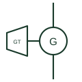

# Gas turbine generator

A combustion gas turbine coupled to a synchronous generator, often through a gearbox, shown as a generating unit.

[Canonical reference](https://eloragrid.ai/symbols/gas-turbine-generator) · [Structured record](../entries/gas-turbine-generator.json) · [All references](README.md)

Updated: 2026-10-28. Drawing use: SLD. Reference families: IEC, IEEE / ANSI.

## What it represents

A gas turbine generator uses a continuous-combustion turbine to drive a synchronous generator, often through a reduction gearbox for smaller industrial machines. Units range from microturbines of tens of kilowatts with high-speed alternators and inverters, up to large industrial turbines feeding a medium-voltage bus.
The drawing usually shows a turbine glyph, a trapezoid widening in the direction of flow, joined by a shaft line to the generator circle. A generator step-up transformer, generator breaker and neutral earthing equipment follow on the single-line diagram.
Microturbines with high-speed alternators produce high-frequency output that must pass through a rectifier and inverter, so check whether a converter sits between the machine and the bus. The symbol does not state fuel, start method or ambient derating.

## How to read it

- A trapezoid on the shaft line indicates the turbine; a gearbox may be drawn as a small box between turbine and generator.
- Look for a converter stage on microturbine packages.

## Drawing checklist

- State ISO rating and site derating.
- Show gearbox, generator breaker and earthing.
- Reference start system and black-start capability.

## Important distinction

A gas turbine is a continuous-combustion rotating prime mover; a gas engine is reciprocating.

## Facts

- Prime mover: Combustion turbine
- Coupling: Direct or through gearbox
- Microturbine variant: High-speed alternator with converter
- Preview: Independent educational illustration; consult the applicable standard and project legend for the exact graphic

## Public references

- [IEEE/ANSI 315-1975: graphic symbols for electrical and electronics diagrams](https://standards.ieee.org/ieee/315/515/) — IEEE Standards Association. Graphic-symbol standards context for machines and prime movers.
- [AutoCAD Electrical: Power station and substation concepts](https://help.autodesk.com/cloudhelp/2021/ENU/AutoCAD-Electrical/files/GUID-74EF80E8-018D-4A57-88BD-FF973F1B8185.htm) — Autodesk. Public power station representation context.

## Related references

- [Three-phase synchronous generator](three-phase-synchronous-generator.md)
- [Gas engine generator set](gas-engine-generator-set.md)
- [Generator](generator.md)
- [Generator differential protection](87g-generator-differential-protection.md)

Original educational concept geometry, CC BY 4.0. Unitless; not a certified standards glyph or manufacturer footprint.

Elora-authored explanations are CC BY 4.0. Linked standards and manufacturer material retain their own rights. Confirm project requirements using primary sources.
