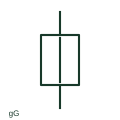

# General-purpose full-range fuse

A gG fuse-link provides full-range overcurrent protection for general applications within its documented ratings.

[Canonical reference](https://eloragrid.ai/symbols/general-purpose-full-range-fuse) · [Structured record](../entries/general-purpose-full-range-fuse.json) · [All references](README.md)

Updated: 2026-10-27. Drawing use: SLD, Schematic. Reference families: IEC, Manufacturer.

## What it represents

A gG fuse-link provides full-range overcurrent protection for general applications within its documented ratings. The fuse symbol is paired with the utilization category and selected current and voltage ratings.

## How to read it

- Coordination requires the actual time-current and let-through data, not the letters alone.
- The preview is an original explanation of this function. Match the actual drawing convention to its legend and the selected equipment documentation.

## Drawing checklist

- Record utilization category
- State rated current and voltage
- Reference breaking and coordination data

## Important distinction

An aM fuse-link has a partial protection range for motor circuits and needs associated overload protection.

## Facts

- Drawing role: Fused circuit
- Representation scope: Functional concept; not an official standard graphic or a product footprint
- Identifier status: The short label is a functional lookup label, not an assigned IEC or IEEE symbol number. Any separately listed Autodesk code is a verified vendor block name.

## Public references

- [Fuse and neutral-link symbols](https://help.autodesk.com/cloudhelp/2021/ENU/AutoCAD-Electrical/files/GUID-E540AE83-CEE1-4CA9-B43C-B19004025EAA.htm) — Autodesk. Public documentation of this equipment function or named vendor variant; the illustration is independently authored and is not the source graphic.
- [Elementary switching devices](https://www.electrical-installation.org/enwiki/Elementary_switching_devices) — Schneider Electric — Electrical Installation Guide. Public documentation of this equipment function or named vendor variant; the illustration is independently authored and is not the source graphic.

## Related references

- [Fuse](fuse.md)
- [Load-break switch](load-break-switch.md)

Original educational concept geometry, CC BY 4.0. Unitless; not a certified standards glyph or manufacturer footprint.

Elora-authored explanations are CC BY 4.0. Linked standards and manufacturer material retain their own rights. Confirm project requirements using primary sources.
