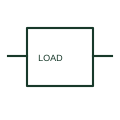

# Generic electrical load

A generic electrical load identifies a documented consuming circuit or aggregate load on an SLD.

[Canonical reference](https://eloragrid.ai/symbols/generic-electrical-load) · [Structured record](../entries/generic-electrical-load.json) · [All references](README.md)

Updated: 2026-10-27. Drawing use: SLD, Schematic. Reference families: IEC, Manufacturer.

## What it represents

A generic electrical load identifies a documented consuming circuit or aggregate load on an SLD. It is used where the equipment details are supplied through a load schedule or linked schematic.

## How to read it

- Read the load description and ratings rather than assigning a motor function to every load endpoint.
- The preview is an original explanation of this function. Match the actual drawing convention to its legend and the selected equipment documentation.

## Drawing checklist

- Name load reference
- State load rating/type
- Cross-reference load schedule

## Important distinction

A generic load does not imply a specific motor, heater or converter construction.

## Facts

- Drawing role: Supply or network role
- Representation scope: Functional concept; not an official standard graphic or a product footprint
- Public vendor block reference: HDV1\_1-, VDV1\_1- (Autodesk identifiers; not IEC symbol numbers)
- Identifier status: The short label is a functional lookup label, not an assigned IEC or IEEE symbol number. Any separately listed Autodesk code is a verified vendor block name.

## Public references

- [AutoCAD Electrical: One-line load and receptacle](https://help.autodesk.com/cloudhelp/2021/ENU/AutoCAD-Electrical/files/GUID-AF38B0E2-9CF4-4F69-9C2B-09D542998ED7.htm) — Autodesk. Public documentation of this equipment function or named vendor variant; the illustration is independently authored and is not the source graphic.

## Related references

- [Generator](generator.md)
- [Busbar](busbar.md)

Original educational concept geometry, CC BY 4.0. Unitless; not a certified standards glyph or manufacturer footprint.

Elora-authored explanations are CC BY 4.0. Linked standards and manufacturer material retain their own rights. Confirm project requirements using primary sources.
