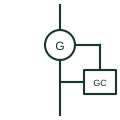

# Genset controller

The device controller that starts, protects and synchronises a generating set and controls its breaker.

[Canonical reference](https://eloragrid.ai/symbols/genset-controller) · [Structured record](../entries/genset-controller.json) · [All references](README.md)

Updated: 2026-10-28. Drawing use: SLD, Schematic. Reference families: IEC, IEEE / ANSI.

## What it represents

A genset controller starts and stops the engine, monitors engine sensors, provides generator protection functions and, in paralleling versions, synchronises the set and shares load with other sources. Automatic mains failure versions also monitor the utility supply and control the changeover.
Single-line diagrams draw it as a block beside the generator with measurement inputs from generator CTs and VTs, a breaker close and trip connection and a communication link to the microgrid or power management controller. The protection functions it provides are often listed by device number.
The block does not tell you whether it provides certified utility interface protection or only generator protection. It also does not show the governor and regulator interface, which may be analogue, digital or a communication link to the engine control unit.

## How to read it

- Read the listed protection functions; they may not include interface protection.
- Check breaker control and synchronising connections.

## Drawing checklist

- List protection and control functions.
- Show measurement and breaker connections.
- Reference governor and regulator interface.

## Important distinction

A genset controller handles one set; a microgrid controller coordinates many sources.

## Facts

- Functions: Start, protect, synchronise, share load
- Inputs: Generator CTs and VTs, engine sensors
- Outputs: Breaker control, governor and AVR commands
- Preview: Independent educational illustration; consult the applicable standard and project legend for the exact graphic

## Public references

- [Single genset controllers for backup power](https://www.deif.com/products/controllers/engine-and-single-genset-controllers/) — DEIF. Public single genset controller page describing start, stop and protection functions.
- [iE 250 controller documentation](https://www.deif.com/documentation/ie-250) — DEIF. Public controller documentation.

## Related references

- [Diesel generator set](diesel-generator-set.md)
- [Microgrid controller](microgrid-controller.md)
- [Generator paralleling controller](ga-generator-paralleling-controller.md)
- [Synchronism check](25-synchronism-check.md)

Original educational concept geometry, CC BY 4.0. Unitless; not a certified standards glyph or manufacturer footprint.

Elora-authored explanations are CC BY 4.0. Linked standards and manufacturer material retain their own rights. Confirm project requirements using primary sources.
