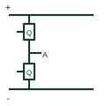

# Half-bridge power module

A packaged power-switch arrangement forming one half-bridge switching leg.

[Canonical reference](https://eloragrid.ai/symbols/half-bridge-power-module) · [Structured record](../entries/half-bridge-power-module.json) · [All references](README.md)

Updated: 2026-10-27. Drawing use: Schematic. Reference families: Manufacturer.

## What it represents

A packaged power-switch arrangement forming one half-bridge switching leg.
On a schematic, identify positive/negative DC terminals, switching midpoint and separate gate/return pins and trace the converter phase leg and driver interfaces. Keep the component tag and signal/reference names consistent across the control drawing, terminal schedule and device documentation.
The module topology does not define its ratings or package terminal order; the selected module drawing remains authoritative.
Terminal letters describe electrical roles, not package pin numbers. Check the selected public datasheet for the actual pin assignment, polarity and any internally connected terminals before completing the drawing.

## How to read it

- Identify positive/negative DC terminals, switching midpoint and separate gate/return pins.
- Trace the converter phase leg and driver interfaces.

## Drawing checklist

- Label positive/negative DC terminals, switching midpoint and separate gate/return pins.
- Cross-reference the converter phase leg and driver interfaces.
- Add the selected device or circuit documentation revision, power/reference connections and project signal convention.

## Important distinction

The module topology does not define its ratings or package terminal order; the selected module drawing remains authoritative.

## Facts

- Common schematic mnemonic: HB-MOD — descriptive only; project/device documentation defines reference designations.
- Terminal / interface focus: Positive/negative DC terminals, switching midpoint and separate gate/return pins
- Artwork scope: Original educational component glyph; not a certified standard graphic or package pinout.

## Public references

- [Power semiconductor module families](https://www.infineon.com/products/power/modules) — Infineon Technologies. Public primary manufacturer documentation establishes the component function or circuit/topology relationship. Preview geometry and drafting explanations are independently authored.

## Related references

- [Insulated-gate bipolar transistor](insulated-gate-bipolar-transistor.md)
- [Diode](diode.md)

Original educational concept geometry, CC BY 4.0. Unitless; not a certified standards glyph or manufacturer footprint.

Elora-authored explanations are CC BY 4.0. Linked standards and manufacturer material retain their own rights. Confirm project requirements using primary sources.
