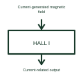

# Hall-effect current sensor

A Hall-effect current sensor uses a magnetic-field response to measure current.

[Canonical reference](https://eloragrid.ai/symbols/hall-effect-current-sensor) · [Structured record](../entries/hall-effect-current-sensor.json) · [All references](README.md)

Updated: 2026-10-27. Drawing use: Schematic. Reference families: Manufacturer.

## What it represents

A Hall-effect current sensor uses a magnetic-field response to measure current.
An appropriately selected sensor can report current in a battery or power-conversion circuit.
Identify the current-carrying conductor and the sensor’s signal output separately. Hall sensing uses the conductor’s magnetic field to obtain current information. Unlike a conventional AC current transformer, a suitable Hall-based sensor can be selected for measurements involving DC; its actual range and isolation remain product-specific. This is original functional artwork, not a certified standard graphic or device pinout.

## How to read it

- Show the current path and positive measurement direction.
- Identify signal supply, reference and output type.
- Reference the selected sensor’s current and insulation specifications.
- Hall sensing and a conventional AC current transformer have different operating principles and limits.

## Drawing checklist

- Show the current path and positive measurement direction.
- Identify signal supply, reference and output type.
- Reference the selected sensor’s current and insulation specifications.

## Important distinction

Hall sensing and a conventional AC current transformer have different operating principles and limits.

## Facts

- Representation type: Original functional block; not a certified IEC or IEEE graphic
- Concept input: Current-generated magnetic field
- Concept output: Current-related output

## Public references

- [Hall-effect current-sensing example](https://www.ti.com/product/TMCS1100) — Texas Instruments. Primary-source technical context for this particular function; product-specific ratings remain with the manufacturer.

## Related references

- [Temperature measuring transducer](temperature-measuring-transducer.md)
- [Magnetic position sensor](magnetic-position-sensor.md)
- [Inductive position sensor](inductive-position-sensor.md)
- [Ultrasonic distance sensor](ultrasonic-distance-sensor.md)

Original educational concept geometry, CC BY 4.0. Unitless; not a certified standards glyph or manufacturer footprint.

Elora-authored explanations are CC BY 4.0. Linked standards and manufacturer material retain their own rights. Confirm project requirements using primary sources.
