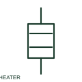

# Heating element

A heating element converts electrical energy to heat in a documented circuit.

[Canonical reference](https://eloragrid.ai/symbols/heating-element) · [Structured record](../entries/heating-element.json) · [All references](README.md)

Updated: 2026-10-27. Drawing use: SLD, Schematic. Reference families: IEC, Manufacturer.

## What it represents

A heating element converts electrical energy to heat in a documented circuit. Its supply, power rating and control/protection path need to be identified for cabinet or auxiliary-system use.

## How to read it

- Trace the thermostat or control device separately from the element.
- The preview is an original explanation of this function. Match the actual drawing convention to its legend and the selected equipment documentation.

## Drawing checklist

- State voltage and power
- Reference control thermostat
- Show overcurrent protection

## Important distinction

A heater is a load; its thermostat is a separate switching or measurement function.

## Facts

- Drawing role: Passive circuit element
- Representation scope: Functional concept; not an official standard graphic or a product footprint
- Public vendor block reference: HRE1HT, VRE1HT (Autodesk identifiers; not IEC symbol numbers)
- Identifier status: The short label is a functional lookup label, not an assigned IEC or IEEE symbol number. Any separately listed Autodesk code is a verified vendor block name.

## Public references

- [Resistors and heater-element symbols](https://help.autodesk.com/cloudhelp/2021/ENU/AutoCAD-Electrical/files/GUID-1D071951-D38E-4B15-8B9E-C30ECBD55C19.htm) — Autodesk. Public documentation of this equipment function or named vendor variant; the illustration is independently authored and is not the source graphic.

## Related references

- [Resistor](resistor.md)
- [Capacitor](capacitor.md)

Original educational concept geometry, CC BY 4.0. Unitless; not a certified standards glyph or manufacturer footprint.

Elora-authored explanations are CC BY 4.0. Linked standards and manufacturer material retain their own rights. Confirm project requirements using primary sources.
