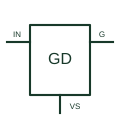

# High-side gate driver

Drives a high-side power transistor with the output circuit referenced to its switching node.

[Canonical reference](https://eloragrid.ai/symbols/high-side-gate-driver) · [Structured record](../entries/high-side-gate-driver.json) · [All references](README.md)

Updated: 2026-10-27. Drawing use: Schematic. Reference families: Manufacturer.

## What it represents

Drives a high-side power transistor with the output circuit referenced to its switching node.
On a schematic, identify the floating supply, switching-node return and control input and trace the high-side gate connection and bootstrap or isolated supply. Keep the component tag and signal/reference names consistent across the control drawing, terminal schedule and device documentation.
A high-side driver needs the correct floating reference; a low-side driver connected to ground does not replace that arrangement.
The preview is an independently drawn educational functional reference. Add the selected component’s actual power pins, terminal numbers, timing or analogue reference details when producing a construction drawing.

## How to read it

- Identify the floating supply, switching-node return and control input.
- Trace the high-side gate connection and bootstrap or isolated supply.

## Drawing checklist

- Label the floating supply, switching-node return and control input.
- Cross-reference the high-side gate connection and bootstrap or isolated supply.
- Add the selected device or circuit documentation revision, power/reference connections and project signal convention.

## Important distinction

A high-side driver needs the correct floating reference; a low-side driver connected to ground does not replace that arrangement.

## Facts

- Common schematic mnemonic: HS-GD — descriptive only; project/device documentation defines reference designations.
- Terminal / interface focus: The floating supply, switching-node return and control input
- Artwork scope: Original educational functional/circuit reference; not a selected product pinout.

## Public references

- [UCC27714 — high-side and low-side gate drive with bootstrap context](https://www.ti.com/product/UCC27714) — Texas Instruments. Public primary manufacturer documentation establishes the component function or circuit/topology relationship. Preview geometry and drafting explanations are independently authored.

## Related references

- [Low-side gate driver](low-side-gate-driver.md)
- [Diode](diode.md)

Original educational concept geometry, CC BY 4.0. Unitless; not a certified standards glyph or manufacturer footprint.

Elora-authored explanations are CC BY 4.0. Linked standards and manufacturer material retain their own rights. Confirm project requirements using primary sources.
