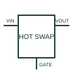

# Hot-swap controller

Controls a power path during equipment insertion or power-up to manage the documented inrush sequence.

[Canonical reference](https://eloragrid.ai/symbols/hot-swap-controller) · [Structured record](../entries/hot-swap-controller.json) · [All references](README.md)

Updated: 2026-10-27. Drawing use: Schematic. Reference families: Manufacturer.

## What it represents

Controls a power path during equipment insertion or power-up to manage the documented inrush sequence.
On a schematic, identify the sense resistor, external switch, timing and fault pins and trace the power-entry connection and power-good/fault interface. Keep the component tag and signal/reference names consistent across the control drawing, terminal schedule and device documentation.
Hot-swap control addresses insertion and startup behaviour; it is not a generic mechanical isolating switch.
The preview is an independently drawn educational functional reference. Add the selected component’s actual power pins, terminal numbers, timing or analogue reference details when producing a construction drawing.

## How to read it

- Identify the sense resistor, external switch, timing and fault pins.
- Trace the power-entry connection and power-good/fault interface.

## Drawing checklist

- Label the sense resistor, external switch, timing and fault pins.
- Cross-reference the power-entry connection and power-good/fault interface.
- Add the selected device or circuit documentation revision, power/reference connections and project signal convention.

## Important distinction

Hot-swap control addresses insertion and startup behaviour; it is not a generic mechanical isolating switch.

## Facts

- Common schematic mnemonic: HOT-SWAP — descriptive only; project/device documentation defines reference designations.
- Terminal / interface focus: The sense resistor, external switch, timing and fault pins
- Artwork scope: Original educational functional/circuit reference; not a selected product pinout.

## Public references

- [LTC4215 — hot-swap power-path control](https://www.analog.com/en/products/ltc4215.html) — Analog Devices. Public primary manufacturer documentation establishes the component function or circuit/topology relationship. Preview geometry and drafting explanations are independently authored.

## Related references

- [N-channel enhancement MOSFET](n-channel-enhancement-mosfet.md)
- [Diode](diode.md)

Original educational concept geometry, CC BY 4.0. Unitless; not a certified standards glyph or manufacturer footprint.

Elora-authored explanations are CC BY 4.0. Linked standards and manufacturer material retain their own rights. Confirm project requirements using primary sources.
