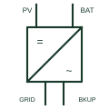

# Hybrid inverter

A single inverter with PV, battery and AC ports, combining MPPT charging, battery inversion and backup output.

[Canonical reference](https://eloragrid.ai/symbols/hybrid-inverter) · [Structured record](../entries/hybrid-inverter.json) · [All references](README.md)

Updated: 2026-10-28. Drawing use: SLD. Reference families: IEC, IEEE / ANSI, Manufacturer.

## What it represents

A hybrid inverter combines a solar maximum power point tracker, a bidirectional battery converter and an AC inverter in one unit. It typically has three port types: PV DC input, battery DC terminals and an AC grid connection, with many models adding a separate backup or essential load output that stays energised during a network outage.
Single-line diagrams show one inverter block with multiple DC inputs and one or two AC outputs, and the internal DC bus is sometimes drawn as a dashed line. The essential load board, isolators for each port and the grid connection point should all be shown.
The symbol does not state how fast the backup output transfers, whether the battery can be charged from the grid, or what export limit applies. Those depend on the settings and on network operator rules, not on the block itself.

## How to read it

- Identify every DC and AC port and its isolator.
- Separate the backup output circuits from normal circuits.

## Drawing checklist

- State PV, battery and AC ratings.
- Show backup load board and isolators.
- Reference export limit and transfer behaviour.

## Important distinction

A hybrid inverter includes PV and battery ports in one unit; an inverter-charger usually has a battery port only and relies on separate solar chargers.

## Facts

- Ports: PV, battery, grid, often backup AC
- Internal stages: MPPT, battery converter, inverter
- Preview: Independent educational illustration; not a product outline

## Public references

- [Multi RS Solar official product and documents](https://www.victronenergy.com/inverter-charger-mppt/multi-rs-solar) — Victron Energy. Public combined inverter, charger and solar tracker documentation.
- [Solar electrical system architecture](https://www.ti.com/applications/industrial/energy-infrastructure/solar-energy/overview.html) — Texas Instruments. Public solar electrical system architecture context.

## Related references

- [Bidirectional inverter-charger](bidirectional-inverter-charger.md)
- [MPPT solar charge controller](mppt-charge-controller.md)
- [Photovoltaic inverter](photovoltaic-inverter.md)
- [Battery](battery.md)

Original educational concept geometry, CC BY 4.0. Unitless; not a certified standards glyph or manufacturer footprint.

Elora-authored explanations are CC BY 4.0. Linked standards and manufacturer material retain their own rights. Confirm project requirements using primary sources.
