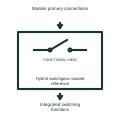

# Hybrid switchgear module reference

Groups the documented integrated primary functions within a selected hybrid switching module.

[Canonical reference](https://eloragrid.ai/symbols/hybrid-switchgear-module-reference) · [Structured record](../entries/hybrid-switchgear-module-reference.json) · [All references](README.md)

Updated: 2026-11-03. Drawing use: Schematic. Reference families: Manufacturer.

Representation: functional-block; installation focus: switchyards.
Module primary connections
Integrated switching functions

## What it represents

Groups the documented integrated primary functions within a selected hybrid switching module. High-voltage primary equipment carries, interrupts, measures or conditions the main power circuit. Its function, insulation arrangement and equipment boundaries need to be distinguished from the secondary signals used to control it.
In a switchyard equipment diagram, the primary reference identifies the electrical role of an installed component while the linked equipment schedule and manufacturer drawing supply its exact construction and dimensions. For this reference, the drawing identifies “Module primary connections” at the input and “Integrated switching functions” at the output. Internal boundaries follow the manufacturer configuration.
Read the connected power path before interpreting a secondary output or alarm. These original educational component references provide no product dimensions, dielectric rating, installation clearance or construction approval. The functional block is an independent explanation of this named application. Equipment-specific ratings, terminal connections and operating conditions must be established in the project documentation.

## How to read it

- Start at the named input: Module primary connections. Identify its source device or document and the state represented on the drawing.
- Follow the named output: Integrated switching functions. Cross-reference its destination and separate the command from confirmation that the equipment responded.
- Internal boundaries follow the manufacturer configuration.
- Read the connected power path before interpreting a secondary output or alarm. These original educational component references provide no product dimensions, dielectric rating, installation clearance or construction approval.

## Drawing checklist

- Label the source and connection reference for module primary connections.
- Identify the destination and defined state of integrated switching functions.
- Record the equipment or control-document revision supporting this functional block.
- Check this application limit in the project design: Internal boundaries follow the manufacturer configuration.

## Important distinction

Internal boundaries follow the manufacturer configuration. This reference describes the named application; it does not establish a new IEC graphical symbol, an ANSI device-function number or an exact manufacturer connection diagram.

## Facts

- Representation: Functional block
- Installation focus: Switchyards
- Input / boundary: Module primary connections
- Output / connection: Integrated switching functions
- Lookup label: HSMR is a library lookup label, not a standard device designation.

## Public references

- [Gas-insulated switchgear](https://www.hitachienergy.com/products-and-solutions/high-voltage-switchgear-and-breakers/gas-insulated-switchgear) — Hitachi Energy. Public technical context for high-voltage primary equipment references. Primary switching equipment and instrument-transformer interfaces. The application text and educational graphic are independently authored; the publisher does not certify this representation.

## Related references

- [Power transformer](power-transformer.md)
- [Capacitor voltage transformer](capacitor-voltage-transformer.md)
- [GIS circuit-breaker compartment reference](gis-circuit-breaker-compartment-reference.md)

Original educational concept geometry, CC BY 4.0. Unitless; not a certified standards glyph or manufacturer footprint.

Elora-authored explanations are CC BY 4.0. Linked standards and manufacturer material retain their own rights. Confirm project requirements using primary sources.
