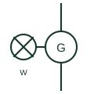

# Hydro turbine generator

A water turbine driving a generator, used for mini and micro hydro sources within microgrids and remote supplies.

[Canonical reference](https://eloragrid.ai/symbols/hydro-turbine-generator) · [Structured record](../entries/hydro-turbine-generator.json) · [All references](README.md)

Updated: 2026-10-28. Drawing use: SLD. Reference families: IEC, IEEE / ANSI.

## What it represents

A hydro turbine generator converts water flow and head into electrical power through a Pelton, Francis, Kaplan or crossflow turbine driving a synchronous or induction generator. In microgrids, small hydro is valuable because it is dispatchable within the limits of the water available and supplies real rotating inertia.
Drawings show a turbine element on the shaft line to the generator circle, sometimes with a governor or a dump-load controller attached. Very small run-of-river units often regulate frequency by diverting surplus power to a ballast load rather than adjusting water flow, so the dump load may appear beside the generator.
The symbol does not state head, flow, runaway speed or whether the unit can operate isolated. Penstock and water-hammer constraints limit how quickly load can change, which is not visible on the electrical drawing.

## How to read it

- A ballast or dump load beside a small hydro set indicates electronic load control instead of a mechanical governor.
- Check whether the generator is synchronous or induction.

## Drawing checklist

- State turbine type, head and flow.
- Show governor or load controller.
- Reference generator type and protection.

## Important distinction

A hydro unit is driven by water; its control differs from a thermal genset because load changes are limited by penstock dynamics.

## Facts

- Prime mover: Water turbine
- Speed control: Governor or electronic ballast load
- Inertia: Rotating machine inertia available
- Preview: Independent educational illustration; consult the applicable standard and project legend for the exact graphic

## Public references

- [AutoCAD Electrical: Power station and substation concepts](https://help.autodesk.com/cloudhelp/2021/ENU/AutoCAD-Electrical/files/GUID-74EF80E8-018D-4A57-88BD-FF973F1B8185.htm) — Autodesk. Public power station representation used as site-level context.
- [IEEE/ANSI 315-1975: graphic symbols for electrical and electronics diagrams](https://standards.ieee.org/ieee/315/515/) — IEEE Standards Association. Graphic-symbol standards context for rotating machines.

## Related references

- [Three-phase synchronous generator](three-phase-synchronous-generator.md)
- [Dump load controller](dump-load-controller.md)
- [Three-phase induction generator](three-phase-induction-generator.md)
- [Generator](generator.md)

Original educational concept geometry, CC BY 4.0. Unitless; not a certified standards glyph or manufacturer footprint.

Elora-authored explanations are CC BY 4.0. Linked standards and manufacturer material retain their own rights. Confirm project requirements using primary sources.
