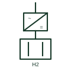

# Hydrogen electrolyser

A DC load that splits water into hydrogen and oxygen, supplied through a rectifier as a controllable sink in a microgrid.

[Canonical reference](https://eloragrid.ai/symbols/hydrogen-electrolyser) · [Structured record](../entries/hydrogen-electrolyser.json) · [All references](README.md)

Updated: 2026-10-28. Drawing use: SLD. Reference families: IEC, IEEE / ANSI.

## What it represents

An electrolyser uses DC current to split water into hydrogen and oxygen. In microgrids and renewable hubs it acts as a large controllable load that can absorb surplus solar or wind generation, with the hydrogen stored for later use in a fuel cell or sold off site.
On a single-line diagram the electrolyser stack appears as a DC load fed from a transformer-rectifier or an active front-end rectifier. Large units show the rectifier transformer, harmonic filtering and a DC busbar to the stack; smaller units may be drawn as a single block labelled with the stack rating.
Thyristor rectifiers for large electrolysers draw significant harmonic current and reactive power, so filters or compensators may be needed. The symbol does not state ramp rate, minimum load or the gas plant constraints that limit how flexibly the electrolyser can follow generation.

## How to read it

- Read the rectifier type to judge harmonic and reactive impact.
- Treat the stack as DC load; its rating is often given in MW of DC input.

## Drawing checklist

- State stack DC rating and ramp limits.
- Show rectifier, transformer and filters.
- Reference minimum load and process interlocks.

## Important distinction

An electrolyser consumes electricity to make hydrogen; a fuel cell consumes hydrogen to make electricity.

## Facts

- Electrical role: Controllable DC load
- Supply: Rectifier from AC network
- Power quality: Rectifier harmonics may need filtering
- Preview: Independent educational illustration; consult the applicable standard and project legend for the exact graphic

## Public references

- [IEC graphical symbols for diagrams](https://tc3.iec.ch/tc-activity/graphical-symbols-for-diagrams/) — IEC. IEC graphical symbol context for loads and conversion elements.
- [Battery energy storage and power conversion](https://www.eaton.com/sg/en-us/products/energy-storage.html) — Eaton. Public power conversion context for storage-type systems.

## Related references

- [Fuel cell](fuel-cell.md)
- [Thyristor phase-controlled rectifier](thyristor-phase-controlled-rectifier.md)
- [Active front-end rectifier](active-front-end-rectifier.md)
- [Generic electrical load](generic-electrical-load.md)

Original educational concept geometry, CC BY 4.0. Unitless; not a certified standards glyph or manufacturer footprint.

Elora-authored explanations are CC BY 4.0. Linked standards and manufacturer material retain their own rights. Confirm project requirements using primary sources.
