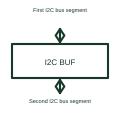

# I2C bus buffer

An I2C bus buffer separates or supports selected parts of an I2C connection.

[Canonical reference](https://eloragrid.ai/symbols/i2c-bus-buffer) · [Structured record](../entries/i2c-bus-buffer.json) · [All references](README.md)

Updated: 2026-10-27. Drawing use: Schematic. Reference families: Manufacturer.

## What it represents

An I2C bus buffer separates or supports selected parts of an I2C connection.
A design can use a suitable buffer to manage loading between bus segments.
Show the bus segment on each side of the buffer and identify the clock and data paths. Buffers can manage electrical loading, but their permitted direction behaviour and connections vary. They should not be drawn as ordinary logic buffers without checking how they handle the selected I2C bus. This is original functional artwork, not a certified standard graphic or device pinout.

## How to read it

- Identify clock and data on both segments.
- Reference pull-up and loading requirements for each side.
- Check the selected buffer’s permitted bus arrangement.
- Buffer behaviour, direction handling and supported bus conditions depend on the selected device.

## Drawing checklist

- Identify clock and data on both segments.
- Reference pull-up and loading requirements for each side.
- Check the selected buffer’s permitted bus arrangement.

## Important distinction

Buffer behaviour, direction handling and supported bus conditions depend on the selected device.

## Facts

- Representation type: Original functional block; not a certified IEC or IEEE graphic
- Concept input: First I2C bus segment
- Concept output: Second I2C bus segment

## Public references

- [I2C, I3C and SPI interface functions](https://www.ti.com/product-category/interface/i2c-i3c-ics/overview.html) — Texas Instruments. I2C, I3C and SPI interface functions: public technical context for the named function. Product and compliance details remain with the publisher.

## Related references

- [Logic voltage-level translator](logic-voltage-level-translator.md)
- [I2C voltage-level translator](i2c-level-translator.md)
- [SPI interface buffer](spi-interface-buffer.md)
- [Power converter / inverter](power-converter.md)

Original educational concept geometry, CC BY 4.0. Unitless; not a certified standards glyph or manufacturer footprint.

Elora-authored explanations are CC BY 4.0. Linked standards and manufacturer material retain their own rights. Confirm project requirements using primary sources.
