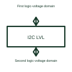

# I2C voltage-level translator

An I2C level translator adapts the specified logic-voltage levels between compatible bus sections.

[Canonical reference](https://eloragrid.ai/symbols/i2c-level-translator) · [Structured record](../entries/i2c-level-translator.json) · [All references](README.md)

Updated: 2026-10-27. Drawing use: Schematic. Reference families: Manufacturer.

## What it represents

An I2C level translator adapts the specified logic-voltage levels between compatible bus sections.
Two devices with different supported logic supplies may communicate through a suitable translator.
Label the supply voltage domain on each side and show both I2C signals. Voltage translation lets compatible logic interfaces work across selected voltage levels; it does not automatically create a safety-rated isolation barrier. Follow the chosen translator’s requirements for pull-ups and power sequencing. This is original functional artwork, not a certified standard graphic or device pinout.

## How to read it

- Identify both logic-supply domains.
- Show clock/data connections and their selected pull-ups.
- Reference supported voltage, bus and startup conditions.
- Voltage translation is different from electrical isolation across a rated barrier.

## Drawing checklist

- Identify both logic-supply domains.
- Show clock/data connections and their selected pull-ups.
- Reference supported voltage, bus and startup conditions.

## Important distinction

Voltage translation is different from electrical isolation across a rated barrier.

## Facts

- Representation type: Original functional block; not a certified IEC or IEEE graphic
- Concept input: First logic-voltage domain
- Concept output: Second logic-voltage domain

## Public references

- [I2C, I3C and SPI interface functions](https://www.ti.com/product-category/interface/i2c-i3c-ics/overview.html) — Texas Instruments. I2C, I3C and SPI interface functions: public technical context for the named function. Product and compliance details remain with the publisher.

## Related references

- [Logic voltage-level translator](logic-voltage-level-translator.md)
- [I2C bus buffer](i2c-bus-buffer.md)
- [SPI interface buffer](spi-interface-buffer.md)
- [Power converter / inverter](power-converter.md)

Original educational concept geometry, CC BY 4.0. Unitless; not a certified standards glyph or manufacturer footprint.

Elora-authored explanations are CC BY 4.0. Linked standards and manufacturer material retain their own rights. Confirm project requirements using primary sources.
