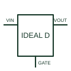

# Ideal-diode controller

Controls an external transistor to obtain the documented low-loss directional or reverse-blocking power path.

[Canonical reference](https://eloragrid.ai/symbols/ideal-diode-controller) · [Structured record](../entries/ideal-diode-controller.json) · [All references](README.md)

Updated: 2026-10-27. Drawing use: Schematic. Reference families: Manufacturer.

## What it represents

Controls an external transistor to obtain the documented low-loss directional or reverse-blocking power path.
On a schematic, identify the input/output sensing nodes and external MOSFET gate/source connections and trace the protected supply path and reverse-current control. Keep the component tag and signal/reference names consistent across the control drawing, terminal schedule and device documentation.
An ideal-diode controller is an active circuit with operating limits; the term does not mean a lossless physical diode.
The preview is an independently drawn educational functional reference. Add the selected component’s actual power pins, terminal numbers, timing or analogue reference details when producing a construction drawing.

## How to read it

- Identify the input/output sensing nodes and external MOSFET gate/source connections.
- Trace the protected supply path and reverse-current control.

## Drawing checklist

- Label the input/output sensing nodes and external MOSFET gate/source connections.
- Cross-reference the protected supply path and reverse-current control.
- Add the selected device or circuit documentation revision, power/reference connections and project signal convention.

## Important distinction

An ideal-diode controller is an active circuit with operating limits; the term does not mean a lossless physical diode.

## Facts

- Common schematic mnemonic: IDEAL-D — descriptive only; project/device documentation defines reference designations.
- Terminal / interface focus: The input/output sensing nodes and external MOSFET gate/source connections
- Artwork scope: Original educational functional/circuit reference; not a selected product pinout.

## Public references

- [LM74700-Q1 — ideal-diode controller](https://www.ti.com/product/LM74700-Q1) — Texas Instruments. Public primary manufacturer documentation establishes the component function or circuit/topology relationship. Preview geometry and drafting explanations are independently authored.

## Related references

- [Redundant power-supply decoupling module](redundant-power-supply-decoupling-module.md)
- [Diode](diode.md)

Original educational concept geometry, CC BY 4.0. Unitless; not a certified standards glyph or manufacturer footprint.

Elora-authored explanations are CC BY 4.0. Linked standards and manufacturer material retain their own rights. Confirm project requirements using primary sources.
