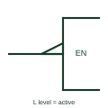

# IEC polarity indicator at input (active-low input)

Small triangle on an input lead meaning a low level produces the internal active state.

[Canonical reference](https://eloragrid.ai/symbols/iec-active-low-input-indicator) · [Structured record](../entries/iec-active-low-input-indicator.json) · [All references](README.md)

Updated: 2026-10-28. Drawing use: Schematic. Reference families: IEC, Manufacturer.

Graphical convention: IEC. Right-angled triangle on the input line next to the outline.

## What it represents

The polarity indicator is a small right-angled triangle drawn on the input line where it meets the outline. It states that the L level produces the internal 1 state. Because it refers directly to levels, it does not need a positive or negative logic declaration, which is why device data books favour it.
On drawings that combine device-level schematics with functional logic, the polarity triangle tells the reader that a pin is active low, such as an enable, chip-select or reset input. In positive logic it means the same as a negation circle.
The triangle does not indicate an internal pull-up or default state for an unconnected input. Those details are device data.

## How to read it

- Read the triangle as active when low.
- Equivalent to a negation circle only in positive logic.

## Drawing checklist

- Draw the triangle on the outside of the outline, pointing in the signal direction.
- Use it consistently in place of circles on level-based schematics.
- Name active-low nets with a consistent suffix or overbar.

## Important distinction

The negation circle is a logic statement that needs a declared convention; the triangle is a level statement.

## Facts

- Meaning: L level produces internal 1
- Equivalent in positive logic: Input negation circle
- Artwork scope: Original educational illustration; consult the applicable standard and the selected device documentation for the exact graphic

## Public references

- [Overview of IEEE Standard 91-1984: explanation of logic symbols (SDYZ001A)](https://www.ti.com/lit/ml/sdyz001a/sdyz001a.pdf) — Texas Instruments. Explains the logic polarity indicator and why data books use it.

## Related references

- [IEC logic negation at input](iec-logic-input-negation.md)
- [IEC polarity indicator at output (active-low output)](iec-active-low-output-indicator.md)
- [IEC enable input (EN)](iec-enable-input.md)

Original educational concept geometry, CC BY 4.0. Unitless; not a certified standards glyph or manufacturer footprint.

Elora-authored explanations are CC BY 4.0. Linked standards and manufacturer material retain their own rights. Confirm project requirements using primary sources.
