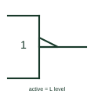

# IEC polarity indicator at output (active-low output)

Triangle on an output lead meaning the internal active state drives the output to a low level.

[Canonical reference](https://eloragrid.ai/symbols/iec-active-low-output-indicator) · [Structured record](../entries/iec-active-low-output-indicator.json) · [All references](README.md)

Updated: 2026-10-28. Drawing use: Schematic. Reference families: IEC, Manufacturer.

Graphical convention: IEC. Right-angled triangle on the output line next to the outline.

## What it represents

At an output, the polarity indicator triangle means the internal 1 state produces an external L level. It is the level-based counterpart of output negation and is used on device symbols for active-low interrupt, ready or fault outputs.
When an active-low output drives an active-low input, the two triangles show directly that the signal is asserted low throughout, which avoids the double-negation reading needed with circles. This makes signal names with a low-active suffix line up with the graphic.
The triangle does not state the output drive type. An active-low open-drain output also needs the open-circuit qualifier inside the outline.

## How to read it

- Read the output as asserted when low.
- Check for an open-circuit qualifier as well.

## Drawing checklist

- Draw the triangle on the output line at the outline edge.
- Name the net to show low-active sense.
- Add any output-type qualifier inside the outline.

## Important distinction

An output negation circle has the same meaning in positive logic but depends on the declared convention.

## Facts

- Meaning: Internal 1 produces L level
- Typical pins: Interrupt, fault, ready outputs
- Artwork scope: Original educational illustration; consult the applicable standard and the selected device documentation for the exact graphic

## Public references

- [Overview of IEEE Standard 91-1984: explanation of logic symbols (SDYZ001A)](https://www.ti.com/lit/ml/sdyz001a/sdyz001a.pdf) — Texas Instruments. Polarity indicator at outputs.

## Related references

- [IEC logic negation at output](iec-logic-output-negation.md)
- [IEC polarity indicator at input (active-low input)](iec-active-low-input-indicator.md)
- [IEC open-circuit output, L-type (open collector)](iec-open-circuit-output-l-type.md)

Original educational concept geometry, CC BY 4.0. Unitless; not a certified standards glyph or manufacturer footprint.

Elora-authored explanations are CC BY 4.0. Linked standards and manufacturer material retain their own rights. Confirm project requirements using primary sources.
