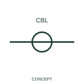

# Additional cable-core marker

An additional-core marker associates another conductor with an existing cable record.

[Canonical reference](https://eloragrid.ai/symbols/iec-additional-cable-core-marker) · [Structured record](../entries/iec-additional-cable-core-marker.json) · [All references](README.md)

Updated: 2026-10-27. Drawing use: Schematic. Reference families: IEC, Manufacturer.

Graphical convention: IEC. Additional cable-core marker.

## What it represents

An additional-core marker associates another conductor with an existing cable record. A child or additional-core marker expands the same cable identity to another conductor. It should preserve both the parent cable association and the unique core designation.
Check the parent/child association when copying or moving circuits. The additional marker is another view of the cable, not another cable to procure.

## How to read it

- Link it to the cable parent and preserve the individual core identity.
- A child cable marker should not be counted as another physical cable.

## Drawing checklist

- Identify the associated device, circuit or diagram boundary.
- Link it to the cable parent and preserve the individual core identity.
- Cross-reference the equipment data, terminal mapping or operating-state legend needed to interpret the form.

## Important distinction

A child cable marker should not be counted as another physical cable.

## Facts

- Reference scope: Specific public IEC-context family form
- Publisher reference token: HW02 (Autodesk token; not a verified IEC database ID)
- Information added: Link it to the cable parent and preserve the individual core identity.
- Preview: Independent educational concept; consult the publisher and applicable standard for the exact graphic

## Public references

- [Autodesk IEC-60617 preview: Cable identification and twisted-pair annotation](https://help.autodesk.com/cloudhelp/2021/ENU/AutoCAD-Electrical/files/GUID-37A08C35-43A3-484D-B0EB-0BBCBC4BE709.htm) — Autodesk. Official public publisher family name and reference context; vendor identifiers and graphics are distinct from licensed IEC database content.

## Related references

- [Terminal connection](terminal.md)
- [Busbar](busbar.md)

Original educational concept geometry, CC BY 4.0. Unitless; not a certified standards glyph or manufacturer footprint.

Elora-authored explanations are CC BY 4.0. Linked standards and manufacturer material retain their own rights. Confirm project requirements using primary sources.
