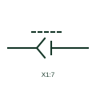

# Additional connector pin

A further pin of a connector already tagged elsewhere, drawn without repeating the connector body or tag.

[Canonical reference](https://eloragrid.ai/symbols/iec-additional-connector-pin) · [Structured record](../entries/iec-additional-connector-pin.json) · [All references](README.md)

Updated: 2026-10-28. Drawing use: Schematic. Reference families: IEC, Manufacturer.

Graphical convention: IEC. 2nd+ Plug/Jack child form.

## What it represents

On schematics a connector often has pins scattered across several circuits and sheets. The first pin carries the connector tag and body, and each additional pin is drawn with a lighter child symbol that refers back to it. This avoids drawing the same connector several times with conflicting tags.
Readers should treat every child pin as part of the parent connector, so separating the connector disconnects all of them. The child symbol does not repeat the connector type or rating, which must be read from the parent. Pin numbers on child symbols must still be unique within the connector.

## How to read it

- Find the parent connector tag for each child pin.
- Remember all child pins separate when the connector is unplugged.

## Drawing checklist

- Cross-reference child pins to the parent.
- Keep pin numbers unique.
- State connector data only on the parent.

## Important distinction

An additional connector pin is a child of a tagged connector; a standalone plug and socket pair is a connector in its own right.

## Facts

- Graphic cue: Plug and jack contact with reference to a parent connector
- Publisher form: 2nd+ Plug/Jack, Autodesk IEC-60617 preview
- Preview: Original educational illustration; consult the publisher and applicable standard for the exact graphic

## Public references

- [AutoCAD Electrical: Connectors](https://help.autodesk.com/cloudhelp/2021/ENU/AutoCAD-Electrical/files/GUID-7175D293-9F4C-485C-8E2D-DE684820D53B.htm) — Autodesk. Public IEC-oriented preview listing 2nd+ plug and jack forms.
- [Autodesk IEEE Symbol Preview — Connectors - No Wirenumber Changes](https://help.autodesk.com/cloudhelp/2021/ENU/AutoCAD-Electrical/files/GUID-0B14FEAB-110A-4DD3-884E-0A2F8F9E76F7.htm) — Autodesk. Public IEEE-oriented preview of the same connector family.

## Related references

- [Multi-pole plug and socket](iec-multi-pole-plug-and-socket.md)
- [Plug and jack with common pin number](iec-plug-jack-common-pin-number.md)
- [Standalone source cross-reference](iec-standalone-source-cross-reference.md)

Original educational concept geometry, CC BY 4.0. Unitless; not a certified standards glyph or manufacturer footprint.

Elora-authored explanations are CC BY 4.0. Linked standards and manufacturer material retain their own rights. Confirm project requirements using primary sources.
