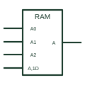

# IEC address dependency (A)

Dependency label A used on memory symbols to show which word of an array the address inputs select.

[Canonical reference](https://eloragrid.ai/symbols/iec-address-dependency-a) · [Structured record](../entries/iec-address-dependency-a.json) · [All references](README.md)

Updated: 2026-10-28. Drawing use: Schematic. Reference families: IEC, Manufacturer.

Graphical convention: IEC. Address inputs grouped to produce A affecting inputs; affected terminals labelled A.

## What it represents

A dependency is used mainly on memory symbols. Address inputs are grouped, often with the binary grouping symbol, to produce internal affecting inputs A0 to An. Data inputs and outputs labelled A then act only on the selected word, so one symbol can represent an entire array.
Reading a memory symbol, start with the address grouping to see the range, then follow the A-labelled data terminals. TI's public overview shows an array of latches forming a small random-access memory using this method.
The notation does not give access time or organisation details beyond word count and width. Those are in the device data.

## How to read it

- Find the address grouping and its range first.
- Terminals labelled A act on the selected word only.

## Drawing checklist

- Show the address bus with its binary grouping.
- Label affected data terminals with A.
- State word count and width in the outline title.

## Important distinction

M dependency selects modes, while A selects which of several identical words is accessed.

## Facts

- Affecting input at 1: Permits action (address selected)
- Typical device: RAM or ROM
- Artwork scope: Original educational illustration; consult the applicable standard and the selected device documentation for the exact graphic

## Public references

- [Overview of IEEE Standard 91-1984: explanation of logic symbols (SDYZ001A)](https://www.ti.com/lit/ml/sdyz001a/sdyz001a.pdf) — Texas Instruments. A (address) dependency and memory array examples.

## Related references

- [IEC random-access memory (RAM)](iec-random-access-memory.md)
- [IEC read-only memory (ROM)](iec-read-only-memory.md)
- [IEC mode dependency (M)](iec-mode-dependency-m.md)

Original educational concept geometry, CC BY 4.0. Unitless; not a certified standards glyph or manufacturer footprint.

Elora-authored explanations are CC BY 4.0. Linked standards and manufacturer material retain their own rights. Confirm project requirements using primary sources.
