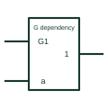

# IEC AND dependency (G)

Dependency label Gm: inputs or outputs carrying the number m are ANDed with the affecting G input.

[Canonical reference](https://eloragrid.ai/symbols/iec-and-dependency-g) · [Structured record](../entries/iec-and-dependency-g.json) · [All references](README.md)

Updated: 2026-10-28. Drawing use: Schematic. Reference families: IEC, Manufacturer.

Graphical convention: IEC. Affecting input labelled Gm with affected inputs or outputs labelled m.

## What it represents

In dependency notation, an input labelled G followed by a number is an affecting input. Every input or output labelled with the same number is ANDed with it. When the G input is at its internal 1 state the affected signals act normally; at its internal 0 state they are forced to 0. A bar over the number means the complement of the G input affects them.
G dependency lets a device symbol show gating relationships without drawing extra AND gates. It is common on multiplexers, gated clocks and register symbols in device data books, and a drafter copying such a symbol must keep the numbers intact or the meaning changes.
The label describes logic only. It does not tell you whether the gating causes glitches on a clock line or what setup time applies between G and the affected input.

## How to read it

- Match each G number to every input or output carrying that number.
- A bar over the affected number means the complement of G applies.

## Drawing checklist

- Keep G numbers unique within a symbol.
- Label every affected terminal with the matching number.
- Avoid mixing G numbers with other dependency letters using the same number.

## Important distinction

V (OR) dependency imposes a 1 state when the affecting input is 1; G imposes a 0 state when the affecting input is 0.

## Facts

- Affecting input at 1: Permits action
- Affecting input at 0: Imposes 0 state
- Artwork scope: Original educational illustration; consult the applicable standard and the selected device documentation for the exact graphic

## Public references

- [Overview of IEEE Standard 91-1984: explanation of logic symbols (SDYZ001A)](https://www.ti.com/lit/ml/sdyz001a/sdyz001a.pdf) — Texas Instruments. Section on G (AND) dependency and summary table of dependency notation.

## Related references

- [IEC OR dependency (V)](iec-or-dependency-v.md)
- [IEC control dependency (C)](iec-control-dependency-c.md)
- [IEC multiplexer (MUX)](iec-multiplexer.md)

Original educational concept geometry, CC BY 4.0. Unitless; not a certified standards glyph or manufacturer footprint.

Elora-authored explanations are CC BY 4.0. Linked standards and manufacturer material retain their own rights. Confirm project requirements using primary sources.
