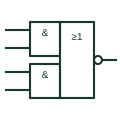

# IEC AND-OR-invert element

Two & elements embedded in a ≥1 element with negated output, drawn as one compound IEC AND-OR-invert symbol.

[Canonical reference](https://eloragrid.ai/symbols/iec-and-or-invert-gate) · [Structured record](../entries/iec-and-or-invert-gate.json) · [All references](README.md)

Updated: 2026-10-28. Drawing use: Schematic. Reference families: IEC, Manufacturer.

Graphical convention: IEC. Embedded & elements abutting a ≥1 element with negated output.

## What it represents

The IEC system draws an AND-OR-invert as several & elements abutted against the left side of a ≥1 element, whose output is negated. Because the common line between the & and ≥1 parts is perpendicular to the signal flow, each & element is understood to feed one input of the OR.
AOI structures appear in older TTL-based control boards and in some gate-array documentation. On a drawing they compress several gates into one symbol, so the reader should expand the function mentally as the complement of a sum of products before checking a truth table.
The compound symbol does not show internal timing or whether unused AND inputs are tied. Unused inputs on the physical device must be handled as the datasheet requires.

## How to read it

- Read the embedded & elements as product terms feeding the ≥1 element.
- Remember the final negation at the output.

## Drawing checklist

- Abut the & elements cleanly to the ≥1 outline.
- Label every input.
- Show the tie-off for unused inputs.

## Important distinction

Separate AND gates wired to a NOR gate perform the same function but are drawn as distinct elements with visible interconnections.

## Facts

- Structure: & elements embedded in ≥1 with output negation
- Boolean form: NOT((A AND B) OR (C AND D))
- Artwork scope: Original educational illustration; consult the applicable standard and the selected device documentation for the exact graphic

## Public references

- [Overview of IEEE Standard 91-1984: explanation of logic symbols (SDYZ001A)](https://www.ti.com/lit/ml/sdyz001a/sdyz001a.pdf) — Texas Instruments. Explains abutted and embedded outlines and their implied connections.
- [SN74LS51 AND-OR-invert gates](https://www.ti.com/lit/ds/symlink/sn74ls51.pdf) — Texas Instruments. Manufacturer AND-OR-invert gate documentation.

## Related references

- [ANSI AND-OR-invert gate](ansi-and-or-invert-gate.md)
- [IEC AND gate (rectangular form)](iec-and-gate.md)
- [IEC NOR gate (rectangular form)](iec-nor-gate.md)

Original educational concept geometry, CC BY 4.0. Unitless; not a certified standards glyph or manufacturer footprint.

Elora-authored explanations are CC BY 4.0. Linked standards and manufacturer material retain their own rights. Confirm project requirements using primary sources.
