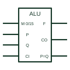

# IEC arithmetic logic unit (ALU)

IEC element marked ALU, performing arithmetic or logic functions on two words as chosen by mode inputs.

[Canonical reference](https://eloragrid.ai/symbols/iec-arithmetic-logic-unit) · [Structured record](../entries/iec-arithmetic-logic-unit.json) · [All references](README.md)

Updated: 2026-10-28. Drawing use: Schematic. Reference families: IEC, Manufacturer.

Graphical convention: IEC. Rectangular element with ALU qualifier and mode-select inputs.

## What it represents

The ALU qualifier identifies an element that can perform several arithmetic and logic operations on input words P and Q. Function-select inputs use M dependency or a binary grouping to choose the operation, and outputs include the result, carry and often a P=Q flag. Because the function table is large, the symbol usually refers to a table on the drawing or in the datasheet.
ALU symbols appear in processor and controller block diagrams and in legacy logic boards. On a modern control drawing they mainly document programmable logic or explain how a processor module handles signals.
The ALU qualifier does not list the operations. A function table is essential and should be referenced explicitly. Preserve the mode-select signal names and the carry interpretation when comparing the symbol with that table.

## How to read it

- Find the function table referenced by the mode inputs.
- Check carry and comparison outputs.

## Drawing checklist

- Mark the element ALU.
- Reference the function table.
- Show carry and flag outputs.

## Important distinction

The Σ element only adds; the ALU selects among many operations, including subtraction and logic functions.

## Facts

- Qualifier: ALU
- Function selection: Mode inputs referencing a table
- Artwork scope: Original educational illustration; consult the applicable standard and the selected device documentation for the exact graphic

## Public references

- [Overview of IEEE Standard 91-1984: explanation of logic symbols (SDYZ001A)](https://www.ti.com/lit/ml/sdyz001a/sdyz001a.pdf) — Texas Instruments. Lists ALU as a general qualifier.

## Related references

- [IEC adder (Σ)](iec-full-adder.md)
- [IEC magnitude comparator (COMP)](iec-magnitude-comparator.md)
- [Binary full adder](binary-full-adder.md)

Original educational concept geometry, CC BY 4.0. Unitless; not a certified standards glyph or manufacturer footprint.

Elora-authored explanations are CC BY 4.0. Linked standards and manufacturer material retain their own rights. Confirm project requirements using primary sources.
