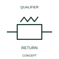

# Automatic mechanical-return indication

This indication identifies the automatic return behaviour of a mechanical control relationship.

[Canonical reference](https://eloragrid.ai/symbols/iec-automatic-mechanical-return-indication) · [Structured record](../entries/iec-automatic-mechanical-return-indication.json) · [All references](README.md)

Updated: 2026-10-27. Drawing use: Schematic. Reference families: IEC, Manufacturer.

Graphical convention: IEC. Automatic mechanical-return indication.

## What it represents

This indication identifies the automatic return behaviour of a mechanical control relationship.
Show the rest position and the force or condition removed to allow return.
Mechanical return behaviour is separate from electrical contact normal state.

## How to read it

- Show the rest position and the force or condition removed to allow return.
- Mechanical return behaviour is separate from electrical contact normal state.

## Drawing checklist

- Identify the associated device, circuit or diagram boundary.
- Show the rest position and the force or condition removed to allow return.
- Cross-reference the equipment data, terminal mapping or operating-state legend needed to interpret the form.

## Important distinction

Mechanical return behaviour is separate from electrical contact normal state.

## Facts

- Reference scope: Specific public IEC-context family form
- Publisher reference token: Q021207 (Autodesk token; not a verified IEC database ID)
- Information added: Show the rest position and the force or condition removed to allow return.
- Preview: Independent educational concept; consult the publisher and applicable standard for the exact graphic

## Public references

- [Autodesk IEC-60617 preview: Mechanical return and interlock qualifiers](https://help.autodesk.com/cloudhelp/2021/ENU/AutoCAD-Electrical/files/GUID-084BF99C-FD3E-4ECF-A86B-608EF93DF6E5.htm) — Autodesk. Official public publisher family name and reference context; vendor identifiers and graphics are distinct from licensed IEC database content.

## Related references

- [Relay coil](relay-coil.md)
- [Normally open contact](normally-open-contact.md)

Original educational concept geometry, CC BY 4.0. Unitless; not a certified standards glyph or manufacturer footprint.

Elora-authored explanations are CC BY 4.0. Linked standards and manufacturer material retain their own rights. Confirm project requirements using primary sources.
