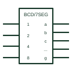

# IEC BCD-to-seven-segment decoder

IEC coder marked BCD/7SEG converting a 4-bit BCD input into seven segment-drive outputs a to g.

[Canonical reference](https://eloragrid.ai/symbols/iec-bcd-to-seven-segment-decoder) · [Structured record](../entries/iec-bcd-to-seven-segment-decoder.json) · [All references](README.md)

Updated: 2026-10-28. Drawing use: Schematic. Reference families: IEC, Manufacturer.

Graphical convention: IEC. X/Y coder with BCD/7SEG qualifier and segment outputs a to g.

## What it represents

The BCD-to-seven-segment decoder is an X/Y coder with the qualifier BCD/7SEG, sometimes written BCD/7-SEG. Inputs are weighted 1, 2, 4 and 8 and outputs are labelled a to g for the display segments. Many devices add lamp test and blanking inputs shown with their own labels.
Seven-segment decoders appear on drawings for local numeric displays, counters and older instrument panels. The output stage type matters: many drivers have open-collector outputs intended to sink LED or lamp current, which should be shown with the open-circuit qualifier.
The symbol does not state segment current, display type (common anode or cathode) or how non-BCD codes are displayed. Those come from the device data and display selection.

## How to read it

- Outputs a to g map to display segments.
- Check output type and display common connection.

## Drawing checklist

- Label segment outputs a to g.
- Show lamp test and blanking inputs where used.
- Show current-limiting resistors and display wiring.

## Important distinction

A BIN/OCT decoder activates one output per code; this coder activates a pattern of segments.

## Facts

- Qualifier: BCD/7SEG
- Example device family: BCD-to-seven-segment decoders/drivers
- Artwork scope: Original educational illustration; consult the applicable standard and the selected device documentation for the exact graphic

## Public references

- [Overview of IEEE Standard 91-1984: explanation of logic symbols (SDYZ001A)](https://www.ti.com/lit/ml/sdyz001a/sdyz001a.pdf) — Texas Instruments. Lists BIN/7-SEG style coder designations.
- [SN74LS47 BCD-to-seven-segment decoders/drivers](https://www.ti.com/lit/ds/symlink/sn74ls47.pdf) — Texas Instruments. Manufacturer BCD-to-seven-segment decoder/driver documentation.

## Related references

- [IEC decade counter (CTR DIV10)](iec-decade-counter.md)
- [IEC binary decoder (X/Y coder)](iec-binary-decoder.md)
- [IEC general code converter (X/Y)](iec-code-converter.md)

Original educational concept geometry, CC BY 4.0. Unitless; not a certified standards glyph or manufacturer footprint.

Elora-authored explanations are CC BY 4.0. Linked standards and manufacturer material retain their own rights. Confirm project requirements using primary sources.
