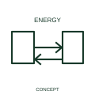

# Bidirectional-energy-flow qualifier

This qualifier identifies an energy interface intended to operate in both directions.

[Canonical reference](https://eloragrid.ai/symbols/iec-bidirectional-energy-flow-qualifier) · [Structured record](../entries/iec-bidirectional-energy-flow-qualifier.json) · [All references](README.md)

Updated: 2026-10-27. Drawing use: SLD, Schematic. Reference families: IEC, Manufacturer.

Graphical convention: IEC. Bidirectional-energy-flow qualifier.

## What it represents

This qualifier identifies an energy interface intended to operate in both directions. Storage and conversion systems can exchange energy in opposite directions under different modes. A bidirectional qualifier describes that capability without defining when either direction is enabled.
Name the charge/discharge or import/export modes and their interfaces. The operating strategy and protective controls are documented separately from the energy-flow mark.

## How to read it

- State the supported operating modes and associated control conditions.
- A bidirectional energy indication does not by itself certify grid-forming or islanding capability.

## Drawing checklist

- Identify the associated device, circuit or diagram boundary.
- State the supported operating modes and associated control conditions.
- Cross-reference the equipment data, terminal mapping or operating-state legend needed to interpret the form.

## Important distinction

A bidirectional energy indication does not by itself certify grid-forming or islanding capability.

## Facts

- Reference scope: Specific public IEC-context family form
- Publisher reference token: Q020508 (Autodesk token; not a verified IEC database ID)
- Information added: State the supported operating modes and associated control conditions.
- Preview: Independent educational concept; consult the publisher and applicable standard for the exact graphic

## Public references

- [Autodesk IEC-60617 preview: Energy-flow qualifiers](https://help.autodesk.com/cloudhelp/2021/ENU/AutoCAD-Electrical/files/GUID-2039C5DD-1C01-4D77-AD97-584052C53D75.htm) — Autodesk. Official public publisher family name and reference context; vendor identifiers and graphics are distinct from licensed IEC database content.

## Related references

- [Power converter / inverter](power-converter.md)
- [PLC input / output](plc-io.md)

Original educational concept geometry, CC BY 4.0. Unitless; not a certified standards glyph or manufacturer footprint.

Elora-authored explanations are CC BY 4.0. Linked standards and manufacturer material retain their own rights. Confirm project requirements using primary sources.
