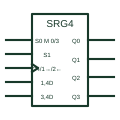

# IEC bidirectional (universal) shift register

IEC shift register with mode inputs that select shift right, shift left, parallel load or hold.

[Canonical reference](https://eloragrid.ai/symbols/iec-bidirectional-shift-register) · [Structured record](../entries/iec-bidirectional-shift-register.json) · [All references](README.md)

Updated: 2026-10-28. Drawing use: Schematic. Reference families: IEC, Manufacturer.

Graphical convention: IEC. SRGm element with mode inputs selecting shift right, shift left and parallel load.

## What it represents

A universal shift register is drawn as an SRG element with two mode-select inputs grouped to produce modes 0 to 3. The clock label shows shift right under one mode and shift left under another, while data inputs are labelled with their mode and control numbers, such as 1,4D for serial right input and 3,4D for parallel load.
These devices are used in data conversion, sequence generation and bidirectional serial links. Reading the compound labels left to right, mode first then clock, tells you exactly when each input is used.
The symbol does not state which mode is safe to change during clocking. Mode changes are normally made with the clock inactive.

## How to read it

- Decode the mode inputs first.
- Compound labels such as 1,4D give mode then clock.

## Drawing checklist

- Show the mode-select grouping.
- Label both shift directions on the clock.
- Label serial and parallel data inputs with their mode numbers.

## Important distinction

A single-direction SRG register has no mode inputs and shifts only one way.

## Facts

- Modes: Hold, shift right, shift left, parallel load
- Notation: M dependency with shift arrows
- Artwork scope: Original educational illustration; consult the applicable standard and the selected device documentation for the exact graphic

## Public references

- [Overview of IEEE Standard 91-1984: explanation of logic symbols (SDYZ001A)](https://www.ti.com/lit/ml/sdyz001a/sdyz001a.pdf) — Texas Instruments. Shift right and left labels and M dependency examples.

## Related references

- [IEC shift register (SRGm)](iec-shift-register.md)
- [IEC mode dependency (M)](iec-mode-dependency-m.md)
- [Parallel-in serial-out register](parallel-in-serial-out-register.md)

Original educational concept geometry, CC BY 4.0. Unitless; not a certified standards glyph or manufacturer footprint.

Elora-authored explanations are CC BY 4.0. Linked standards and manufacturer material retain their own rights. Confirm project requirements using primary sources.
