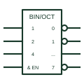

# IEC binary decoder (X/Y coder)

IEC coder marked BIN/OCT or similar, converting a binary input code into one active output.

[Canonical reference](https://eloragrid.ai/symbols/iec-binary-decoder) · [Structured record](../entries/iec-binary-decoder.json) · [All references](README.md)

Updated: 2026-10-28. Drawing use: Schematic. Reference families: IEC, Manufacturer.

Graphical convention: IEC. Rectangular coder with X/Y qualifier such as BIN/OCT.

## What it represents

IEC coders use the general qualifier X/Y, where X is the input code and Y is the output code. A three-to-eight-line decoder is therefore marked BIN/OCT, with input weights 1, 2 and 4 and outputs numbered 0 to 7. Enable inputs are often combined with an & element in the common-control area.
Decoders select one of several devices, relays or indicator lines from a binary code. A drawing should keep the output numbers so a reviewer can confirm that, for example, input code 5 activates output 5.
The qualifier says nothing about output polarity; polarity triangles at outputs show active-low outputs, which are common on decoder devices.

## How to read it

- X/Y gives input and output codes.
- Check output polarity marks before reading the truth table.

## Drawing checklist

- State the code pair, such as BIN/OCT.
- Show input weights.
- Mark active-low outputs.

## Important distinction

A BCD/7SEG coder produces segment drive patterns, not one-of-n outputs.

## Facts

- Qualifier: X/Y, for example BIN/OCT
- Outputs: One-of-n selection
- Artwork scope: Original educational illustration; consult the applicable standard and the selected device documentation for the exact graphic

## Public references

- [Overview of IEEE Standard 91-1984: explanation of logic symbols (SDYZ001A)](https://www.ti.com/lit/ml/sdyz001a/sdyz001a.pdf) — Texas Instruments. X/Y coder qualifier and coder examples.
- [SN74HC138 — binary decoding and demultiplexing](https://www.ti.com/lit/ds/symlink/sn74hc138.pdf) — Texas Instruments. Binary decoder and demultiplexer documentation.

## Related references

- [Binary decoder / demultiplexer](binary-decoder-demultiplexer.md)
- [IEC general code converter (X/Y)](iec-code-converter.md)
- [IEC priority encoder (HPRI/BIN)](iec-priority-encoder.md)

Original educational concept geometry, CC BY 4.0. Unitless; not a certified standards glyph or manufacturer footprint.

Elora-authored explanations are CC BY 4.0. Linked standards and manufacturer material retain their own rights. Confirm project requirements using primary sources.
